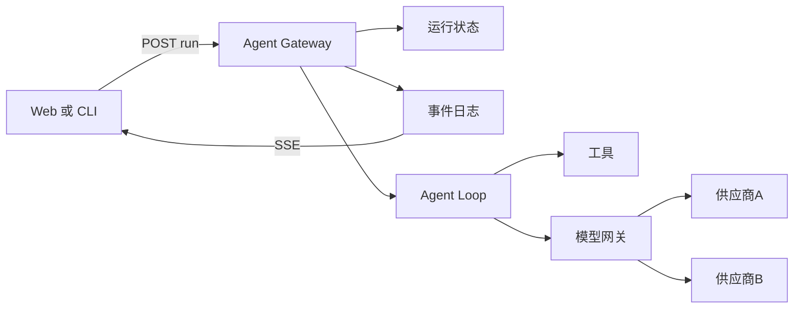
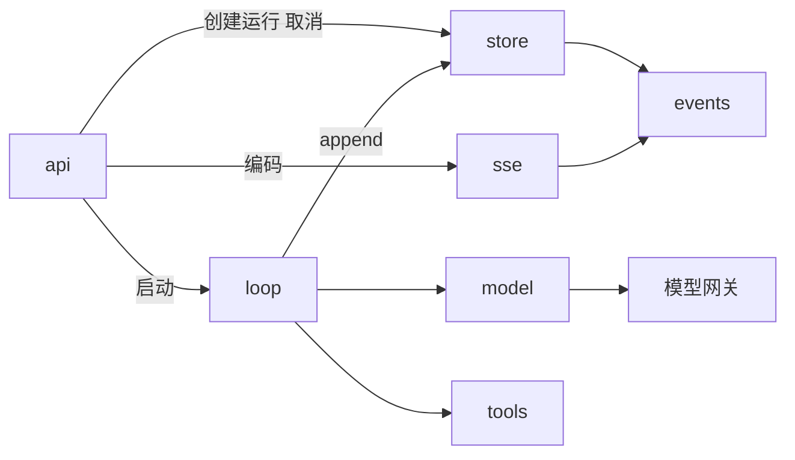

# Streaming Agent Gateway

本目录用于实现 Streaming Agent Gateway。模型路由沿用已有模型网关；本项目要自己写的是「一次 Agent 运行」：有序事件、运行状态、工具副作用，以及把事件用 SSE 推给客户端。

Streaming Agent Gateway 是两层叠在一起：底下是模型流（逐 token），上面是一次 Agent 运行的事件流（文本、工具、状态、结束或失败）。课程第 1 周的 `course_code/week01` 1-2、1-3、1-6、1-7 仍是实现参照。生产上的搭法来自 LiteLLM、Microsoft 流式模型网关、Agent API Gateway 模式、AG-UI、DeerFlow 和 Foundry。

## 先掌握的内容

| 顺序 | 要弄懂的事 | 为什么网关离不开它 | 课程位置 |
| --- | --- | --- | --- |
| 1 | 一次模型调用：消息、Token、Context Window、超时、可重试错误 | 网关要替调用方选模型、记用量、决定要不要重试 | `course_code/week01/1-2` |
| 2 | SSE：`event:`、`data:`、`id:`，以及代理空闲超时 | 流式输出就是一条一直不关的 HTTP 响应 | `course_code/week01/1-3` |
| 3 | Agent Loop：模型可能中途要调工具，再把结果送回去 | 一次用户提问往往是多轮模型调用，不能只转发一段文本 | `course_code/week01/1-1` |
| 4 | 自己的事件类型，而不是原样转发供应商的 chunk | 前端和别的 Agent 需要稳定协议，换模型时不用改客户端 | `1-3` 的类型化事件，`1-6` 的 `content.delta` |
| 5 | 取消、首字节前才能换供应商、断线后怎么续 | 这是流式网关最容易做错的地方 | `1-6`、`course_code/week01/1-7` |
| 6 | 鉴权、限流、用量账本（不存用户正文） | 网关是密钥和成本的唯一出口 | `1-7` 的 `llm-gateway` |

第 7 讲里的网关已经是一个可运行的模型网关：OpenAI 兼容入口、SSE 逐块转发、首个数据块之前才允许重试或切换供应商、客户端断开就关掉上游。Agent Gateway 是在这层外面再加「一次运行」的生命周期。

## 真实案例

| 案例 | 它实际负责 | 本项目采用的做法 |
| --- | --- | --- |
| [LiteLLM Proxy](https://docs.litellm.ai/docs/proxy/architecture) | 模型网关：虚拟密钥、预算、限流、模型组、重试和 fallback | 供应商密钥只放在模型网关。Agent 用一把虚拟密钥调用 `/v1/chat/completions` |
| [Microsoft 流式模型网关](https://github.com/microsoft/agenticai-design-patterns/blob/main/assets/agent-runtime/hosted-agent-streaming-model-gateway/README.md) | 模型网关的流式策略 | 首个 `data:` 之前才能重试；调用方身份和后端密钥分开；先预扣预算再按 usage 结算；账本不存正文 |
| [Agent API Gateway 模式](https://dev.to/jackm-singularity/the-agent-api-gateway-pattern-separate-streaming-state-and-side-effects-5067) | 运行网关 | HTTP 连接不是事实来源。先落有序事件，再推给客户端。运行状态、事件流、工具副作用分成三条通道 |
| [AG-UI 1.0](https://docs.ag-ui.com/spec/1.0/basic/transports/http-sse) | 前端协议 | `POST` 一次运行，响应是 SSE。流打开之前的错误用 HTTP 状态码；流打开之后的错误写在事件里 |
| [DeerFlow Redis Stream Bridge](https://github.com/bytedance/deer-flow/blob/main/backend/packages/harness/deerflow/runtime/stream_bridge/redis.py)、[Foundry 断线续传](https://learn.microsoft.com/en-us/azure/foundry/agents/how-to/stream-with-reconnect) | 多进程续传 | 事件号来自共享日志。任意一台机器都能按 `Last-Event-ID` 接着发 |

AG-UI 的基础绑定不做断线续传，断了就用新的 `runId` 再跑一次。本项目要续传，所以事件号来自 Run Store，沿用 DeerFlow 和 Foundry 的日志回放。

其他对照资料：

- [OpenAI Streaming responses](https://developers.openai.com/api/docs/guides/streaming-responses)：模型侧语义事件，例如 `response.output_text.delta`
- [Kyle Fahey：AI transport layer](https://kylecrfahey.com/writing/engineering-an-ai-transport-layer/)：生成和连接拆开，用可回放的事件流做断线续传

## 架构

两条网关分开。模型网关选供应商、持有密钥、做限流和花费记录。Agent Gateway 管一次运行的状态、事件日志和工具。



三条通道分开存：

- **运行状态。** `queued`、`running`、`waiting_for_approval`、`completed`、`failed`、`cancelled`。带 `thread_id`、调用方、模型别名、创建时间。更新带版本号，避免两个工人同时认领同一步。
- **事件日志。** 只追加。一条 `RunEvent` 一个序号。SSE 只是把日志尾部推出去。订阅断开后，运行继续把事件写入日志；重连用 `GET /v1/runs/{id}/events?since=` 补上。
- **工具副作用。** 写操作带幂等键。超时后先查下游有没有真正完成，再决定要不要重试。读操作可以直接重试。

这三条都放在 Run Store。内存实现和以后的持久化实现共用同一组方法，差异只在存放、事务和通知。约定见 `docs/06-RunStore设计.md`。

模型侧复用 `course_code/week01/1-7/llm-gateway`，或接到 LiteLLM。公开模型名在模型网关里映射成真实供应商。Agent 进程里不放供应商密钥。模型网关的请求路径、换供应商节点和带工具时的处理见 `docs/05-模型网关设计.md`。

记账记调用方、模型、Token、耗时、TTFT、是否发生过切换。TTFT 从这次请求开始，停在第一个非空 `message.delta`。`run.started` 和 `tool.started` 只算 first event。默认不记 Prompt 和回答正文。事件字段以 `docs/02-RunEvent设计.md` 为准。

## thread_id 与 run_id

`thread_id` 标识一段对话，`run_id` 标识这段对话里的一次执行。一次用户发问创建一个 run；用户接着问「那明天呢」，仍使用原来的 `thread_id`，但会得到一个新的 `run_id`。

| | `thread_id` | `run_id` |
| --- | --- | --- |
| 代表什么 | 一段可连续的对话 | 这一次发问的执行 |
| 下面挂着什么 | 按时间排列的消息，以及属于它的多次 run | 一份事件日志、一个状态、一个取消标记 |
| 生命周期 | 跨多次发问保留 | 以 `run.completed`、`run.failed` 或 `run.cancelled` 结束 |
| 客户端怎么用 | 路径 `/v1/threads/{thread_id}/runs`，界面按对话归档 | 取消和补事件都指向这一次运行 |

Store 按 `thread_id` 保存用户消息、工具结果和助手全文。新 run 开始时读出这份消息列表，模型才能看见上一问。事件序号只在同一个 `run_id` 里递增，因此取消和断线补事件不会串到同一对话的另一次发问。

`thread_id` 不是 SSE 连接号，也不是模型供应商的会话号。取消一个 run 只停止这一次执行，这段对话和已经写入的消息还在。

## 模块关系

每个模块是一个目录，目录内再按职责拆文件。后续换成 SQLite、增加回放路由或新工具时，只在对应目录里加文件。依赖保持单向：`events` 不认识网络，SSE 只做对象和文本帧的转换，Agent Loop 只向 Store 追加对象。



第一版目录：

```text
StreamingGateway/
├── app/
│   ├── events/          # RunEvent 与事件种类
│   ├── sse/             # 编解码、心跳
│   ├── model/           # StreamingModel；gateway.py 对接模型网关
│   ├── tools/           # 注册表、超时、读/写区分；每个工具一个文件
│   ├── store/           # 线程、运行状态、事件日志、取消标记
│   ├── loop/            # 一次运行的控制过程
│   ├── prompts/         # 随代码发布的提示词版本、评测和指针
│   ├── api/             # 创建运行、取消；第 10 步在此加回放路由
│   └── main.py          # 组装各目录并启动
├── cli/                 # 第 8 步，解码同一条 SSE。见 docs/09-客户端设计.md
└── tests/               # 与 app 下的目录对应。第 9 步的验收见 docs/10-异常测试设计.md
```

| 目录 | 第一版放什么 | 谁调用它 |
| --- | --- | --- |
| `events/` | `RunEvent`、`EventType`、每种 `data` 的形状 | Store、SSE、测试 |
| `sse/` | `encode`、`decode`、心跳帧 | `api/`、CLI |
| `model/` | `ModelStreamEvent`、`StreamingModel`、网关适配器 | Agent Loop |
| `tools/` | 按名字执行工具，区分读和写。见 `docs/07-AgentLoop与工具注册设计.md` | Agent Loop |
| `store/` | 线程消息、运行状态、按 `seq` 追加和读取、取消标记。见 `docs/06-RunStore设计.md`。持久化和检查点见 `docs/11-数据库与checkpoint设计.md` | Loop、`api/` |
| `loop/` | 调用模型、执行工具、翻译内部事件、收尾。见 `docs/07-AgentLoop与工具注册设计.md` | `api/` |
| `prompts/` | 不可变提示词版本、当前指针、小评测集。见 `docs/13-Prompt工程化管理.md` | `api/`、Agent Loop |
| `api/` | HTTP 状态码、SSE 响应、取消入口。见 `docs/08-创建运行与取消接口设计.md` | 客户端 |

`StreamingModel` 解决的是供应商流式输出的差异，在服务内部提供统一的模型调用。循环只依赖 `stream`，收到文字增量、完整的 `tool_call`、`model.finished`、`model.usage`、`model.failed`。客户端的统一格式仍是 `RunEvent`。

结构是端口、适配器和策略。端口定义 `stream` 和内部事件。每个供应商一个适配器，只做翻译。策略只在还没有可见内容时重试或换路由；已经交出文字或工具参数之后，写成 `model.failed`，不再重放同一条流。调用方取消关掉上游，不记成供应商故障。客户端 SSE 断开则按 `seq` 重放已有事件，不按模型异常处理。

端口、异常分类和重连的完整约定见 `docs/04-StreamingModel设计.md`。循环把内部事件写成 `docs/02-RunEvent设计.md` 中的主干事件。一轮里的工具调用先收齐，在这次模型调用以 `tool_use` 结束后再执行。约定见 `docs/07-AgentLoop与工具注册设计.md`。

一次请求的分工：

1. `api/` 校验入参。失败直接返回 HTTP 4xx，此时还没有 SSE。
2. `store/` 在该 `thread_id` 下创建新的 run，状态变为 `running`，并准备取消标记。
3. `api/` 启动 `loop/`，同时从 `seq` 0 订阅 Store，把新事件编码成 SSE。
4. 客户端断开时，`api/` 停止编码。循环继续写 Store。
5. `POST /cancel` 只设置这个 `run_id` 的取消标记。循环在下一条模型事件或工具返回时看到它，写入 `run.cancelled`，并让 `StreamingModel` 关掉上游连接。一个线程同时只跑一次未结束的 run。状态码、幂等键和 `X-Run-Id` 见 `docs/08-创建运行与取消接口设计.md`。

人工确认用的 `waiting_for_approval` 先留在状态枚举里，前 10 步没有对应目录。用量的独立账本放到第 10 步；第一版只把 usage 放进 `run.completed`。鉴权、限流和供应商密钥留在模型网关。

一次「北京今天热吗」在循环里是这样走的：

```text
写入 run.started
调用 StreamingModel
    模型要求查天气
        写入 tool.started
        写入 tool.arguments.done
    这次模型调用以 tool_use 结束
        执行 get_weather
        写入 tool.result
        把天气结果放回对话
    再次调用 StreamingModel
        写入 message.started
        收到「北京」→ 写入 message.delta
        收到「今天 31 度」→ 写入 message.delta
        写入 message.completed
写入 run.completed
```

同一轮有多个工具时，全部收齐再执行。工具失败写成 `tool.result`，不直接结束这次 run。见 `docs/07-AgentLoop与工具注册设计.md`。

显式取消时写入 `run.cancelled` 并停掉上游。模型报错或输出被截断时写入 `run.failed`。循环自己退出却还没有终态时，补一条 `code` 为 `incomplete-stream` 的 `run.failed`。订阅连接断开只结束这一条 SSE，不取消运行。验收用例见 `docs/10-异常测试设计.md`，这两处收尾见 `docs/12-收尾设计.md`。

`: keep-alive` 由 `sse/` 直接写出，不经过 `RunEvent`，也不进 Run Store。工具或思考阶段每 15 秒写一次，并让反向代理关闭响应缓冲、放宽读超时。帧格式、代理缓冲和订阅者队列见 `docs/03-SSE设计.md`。

## 事件与接口

`RunEvent` 的主干类型、字段和客户端投影见 `docs/02-RunEvent设计.md`。CLI 与 Web 使用同一套编码和同一个 `reduce`。停止走取消接口，断线和刷新只结束本地阅读。传输和呈现上的差别见 `docs/09-客户端设计.md`。一次运行用 `run.started` 开头，用 `run.completed`、`run.failed`、`run.cancelled` 之一结尾。

流还没打开时，鉴权失败和参数错误返回 HTTP 4xx，不发 SSE。响应头已经发出去之后，失败只能是 `run.failed`。这是 AG-UI 的规定。

第一版接口见 `docs/08-创建运行与取消接口设计.md`：

- `POST /v1/threads/{thread_id}/runs`：创建运行。响应是 SSE，同时把事件写入 Store。线程上已有未结束的 run 时返回 409
- `POST /v1/runs/{run_id}/cancel`：只设置取消标记，返回 202。已经取消过的返回 200，已经成功或失败的返回 409
- `GET /v1/runs/{run_id}`：第 7 步做。只读状态和最新序号，不读事件流。Store 的 `since` 只供进程内读取
- `GET /v1/runs/{run_id}/events?since=`：第 10 步做。断线后按序号补事件，和持久化一起做。约定见 `docs/11-数据库与checkpoint设计.md`

生产上更常见的是创建请求很快返回 `run_id` 和事件 URL，事件走另一条连接。第一版把两条合成一个 `POST`，Store 的形状先留好，后面再拆开。

浏览器里多条 SSE 走 HTTP/2。只有客户端必须在同一条连接上持续发指令时，才改用 WebSocket。

## 实现规则

- **同一次模型调用，在可见内容之前才能换供应商。** 可见内容指文字或工具参数，保活帧不算。已经交出内容之后锁定这一家，失败写成 `run.failed`。工具结果写回后的下一次调用可以重新选路。节点见 `docs/05-模型网关设计.md`。
- **带工具时用原始消息重试，不把半截回答拼进下一次提示词。** 工具参数未完整之前不执行工具，也不换一家续写。完整的工具调用执行后，才进入下一次模型调用。LiteLLM 曾把半截文字拼进 fallback，备用模型因此不再调用工具。
- **每次模型调用带一个幂等键。** 模型网关拒绝同一次逻辑调用的重复请求，避免 SDK 自动重试造成双倍计费。
- **订阅者使用有界缓冲。** 客户端读得太慢就断开这条 SSE，并让它从最后的序号重连。运行继续往日志里写。
- **显式取消才停上游。** `POST /cancel` 取消运行和正在进行的模型调用。某个订阅断开，不取消运行。
- **流式接口不做「发出去再纠错」。** JSON Schema 这类严格结构走非流式。
- **工具步骤单独设超时。** 结果分成可重试、不可重试、结果不明。结果不明时先对账，再决定要不要用同一把幂等键重试。约定见 `docs/12-收尾设计.md`。
- **预算先占后结。** 开始前预扣一个上限，结束时按真实 usage 结算。多副本时预扣放在共享存储里。
- **多副本时，事件号来自共享日志。** 单机用内存，随后用 SQLite 的 `seq`。多进程的实时尾部用 Redis Streams。权威日志仍在数据库里。重连先按 `seq` 回放；游标落到保留窗口外就返回缺口。日志只保留够重连的窗口，完整回答另外存一份最终文本。方法见 `docs/06-RunStore设计.md`，表和恢复见 `docs/11-数据库与checkpoint设计.md`。

## 实现顺序

第一版是内存事件日志、一个 Agent Loop、SSE 和显式取消。模型调用交给已有网关。Redis、虚拟密钥和人工确认放在这条链路跑通之后。

| 步骤 | 内容 | 完成标准 |
| --- | --- | --- |
| 1 | 定义 `RunEvent` | `docs/02-RunEvent设计.md` 中的全部主干类型和字段。测试能构造对象并检查字段 |
| 2 | 实现 SSE 编解码 | `RunEvent` 与文本帧互转。心跳不进 Store。这一步就测半截帧 |
| 3 | 抽象 `StreamingModel` | 循环只看到内部模型事件，看不到供应商 chunk |
| 4 | 接入模型网关 | 打到 `course_code/week01/1-7/llm-gateway` 或 LiteLLM。可见内容前可以换路由；带工具时用原始消息重试。约定见 `docs/05-模型网关设计.md` |
| 5 | 实现内存 Run Store | 线程消息、运行状态、取消标记、按 `seq` 追加、按 `since` 读取。数据库留到第 10 步。约定见 `docs/06-RunStore设计.md` |
| 6 | 实现 Agent Loop 和工具注册 | 完成天气式流程。工具放在 `tools/`。显式取消写入 `run.cancelled` 并停掉上游。约定见 `docs/07-AgentLoop与工具注册设计.md` |
| 7 | 创建运行、取消与状态查询 | `api/` 实现创建、取消和 `GET /v1/runs/{run_id}`。订阅断开后 Store 里仍有后续事件。一个线程同时只有一次未结束的 run。事件补发留到第 10 步。约定见 `docs/08-创建运行与取消接口设计.md` |
| 8 | 开发客户端 | 先做 CLI，再做 Web。两者解码同一条 SSE，用同一个 `reduce`。停止走取消接口，离开页面或关掉终端不取消。约定见 `docs/09-客户端设计.md` |
| 9 | 异常测试总验收 | 首字节前可重试；已有正文后只发 `run.failed`；取消会停上游；订阅断开不会停运行。补事件只测 Store 的 `since`。约定见 `docs/10-异常测试设计.md` |
| 10 | 数据库与 checkpoint | 用同一组方法增加 SQLite 持久化，并提供 `GET /events?since=`。Redis Stream 只做多进程实时尾部。用量账本仍不存正文。约定见 `docs/11-数据库与checkpoint设计.md` |

这 10 步的先后不改。每一步的产出都是下一步的输入：事件格式、文本帧、模型接口、网关适配器、内存日志、循环、HTTP、客户端，最后才换持久化。第 9 步验收 Store 已经具备的 `since` 读取；HTTP 回放接口留在第 10 步，避免验收跑到还没实现的路由上。

做完第 1 到第 8 步，就得到一个 Agent、一个模型、SSE、可取消的第一版。断线后的事件留在内存 Store 里，测试可以用 `since` 读回。循环中断的终态和写工具结果不明见 `docs/12-收尾设计.md`。多 Agent 路由、人工确认、独立用量账本和共享存储放在这条链路之后。

## 后续编号

13 到 15 不插入上面的 1 到 10 步。第 13 步已经按「提示词随这次应用一起发布」做完：版本是仓库里的不可变文件，一次 run 记下名称、版本和哈希，评测通过后才移动当前指针。第 14 步只给声明了输出契约的版本接上非流式校验：本地修正围栏和尾逗号，业务规则失败最多修复一次，修不好就完成这次 run 并写出带标记的文字降级。截断、过滤和传输失败仍走原来的失败终态。候选版本可以发布，但不会移动当前指针。第 15 步仍不提前实现。

| 编号 | 内容 |
| --- | --- |
| `docs/13-Prompt工程化管理.md` | 提示词版本、评测、观测和回退。文件目录在 `app/prompts/` |
| `docs/14-结构化输出与失败路径.md` | 声明了输出契约的版本走非流式校验、一次修复和带标记的降级。候选版本不移动当前指针 |
| `docs/15-规则变量分离与注入防护.md` | 固定规则与运行时变量分开，以及注入发生后的执行边界 |
