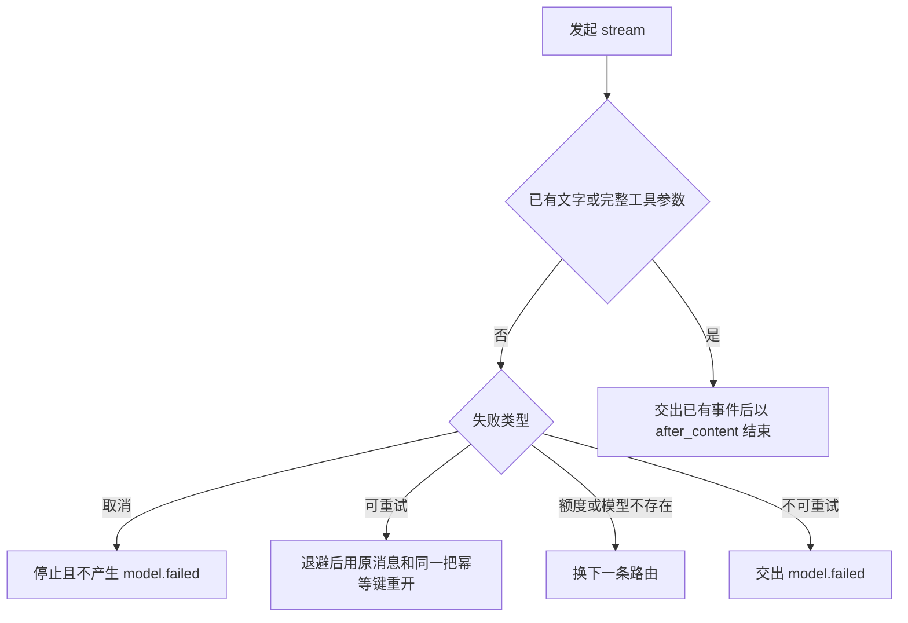

# StreamingModel 设计

`StreamingModel` 抹平供应商在流式输出上的差异，让 Agent 循环只依赖一种模型调用。它统一的是网关内部的模型流。客户端看到的统一格式仍然是 `RunEvent`，由循环翻译后经 SSE 送出。

依据：

- [OpenAI：速率限制与流式错误](https://developers.openai.com/api/docs/guides/rate-limits)
- [Cloudflare：流式响应中途失败](https://www.cloudflare.com/perspectives/what-happens-when-an-ai-provider-fails-during-a-streamed-response/)
- [Gloo：流式失败处理](https://docs.gloo.com/best-practices/completions-streaming-failures)
- [fallback-llm：错误分类](https://github.com/richardsondx/llm-fallback)
- [Forja：Provider 流契约](https://github.com/lex0c/forja/blob/main/docs/PROVIDERS.md)

## 概念

`StreamingModel` 是一次模型调用的流。调用方给出消息、取消信号和幂等键，它持续交出内部事件，直到这次调用结束。

内部事件只描述模型这一次生成：

```text
text.delta          新增的可见文字
tool_call           一次调用的完整参数
model.finished      结束原因，例如 stop、tool_use、length
model.usage         这次调用的 Token
model.failed        这次调用失败
```

这些事件停在适配器里面。循环再把它们写成 `RunEvent`。供应商的原始 SSE 不进入 Store，也不进入客户端。

结构化输出走单独的非流式方法。流式接口不负责把已经发出的内容改成合法 JSON。

## 它解决什么

各家流的形状不一样。OpenAI Chat Completions、Responses 和 Anthropic 的事件名、工具参数增量、用量出现的时机都不同。循环如果直接读这些原始块，换一个供应商就要改循环。

失败的时机也不同。流还没开始时，失败是普通 HTTP 状态码，可以换路由。流已经开始之后，失败变成流里面的一帧，HTTP 已经是 200。OpenAI 写明：已经消费过输出，就不要自动重放这次请求。

取消也要传进适配器。调用方已经走了，上游还在生成，就会继续扣费。取消必须中止上游读取，并且不能被当成供应商故障去重试。

## 设计模型

采用端口、适配器和策略三层：

```text
循环
  │ 只依赖 StreamingModel 这个端口
  ▼
策略层        还没有可见内容时重试或换路由；已有内容后不再续写同一条流
  ▼
适配器        每个供应商一个文件，只做翻译
  ▼
模型网关      保管供应商密钥、虚拟密钥和真实地址
```

| 层 | 职责 |
| --- | --- |
| 端口 | 定义 `stream` 和五种内部事件。循环和测试都对着它写 |
| 适配器 | 把一家供应商的流翻译成这五种事件。新增供应商时只加一个文件 |
| 策略 | 处理还没有可见正文时的重试、退避和换路由。已经有文字或工具参数之后，交出 `model.failed` |

适配器持有模型网关的地址和虚拟密钥。供应商密钥留在模型网关里。

## 统一的范围

这个模块解决的是供应商流式输出的差异，在服务内部提供统一的模型调用。循环不关心这一次打到的是 Chat Completions、Responses 还是 Anthropic，只调用 `stream`，收到的永远是上面五种内部事件。

它不负责给客户端的统一格式。客户端看到的仍是 `RunEvent`，由循环翻译，再经 SSE 送出。

两种断线也不放进同一个接口：

| 断的是什么 | 怎么处理 |
| --- | --- |
| 模型流 | 不能按 token 续上。还没有可见内容时重试或换路由；已经有内容时结束这次调用 |
| 客户端 SSE | 按 `seq` 重放 Store 里已经写下的 `RunEvent`。模型调用还在进行就让它继续，只有取消信号才关掉上游 |

一次 `stream` 对应一次逻辑模型调用，全程使用同一个幂等键。换路由再试时仍用这个键。自动「继续」是下一次调用，使用新键。

```python
class StreamingModel(Protocol):
    def stream(
        self,
        messages: list[dict[str, str]],
        *,
        cancel: asyncio.Event,
        idempotency_key: str,
    ) -> AsyncIterator[ModelStreamEvent]: ...
```

## 异常与处理

先分类，再决定重试、换路由或结束。分类看两件事：失败发生时有没有可见内容，以及它是调用方取消、请求本身错误，还是供应商暂时不可用。



供应商会抛出各自的异常类，有的失败则是 HTTP 200 之后流里的一帧。适配器在边界上把它们收成同一种 `model.failed`。循环只读这一种失败。编程错误，例如适配器自己的缺陷，继续作为异常抛出，不写进这条流。

`model.failed` 的必填字段只有四个。`retry_after_ms` 可选，默认空。适配器把 429 的 `Retry-After` 换算成毫秒放在这里，策略读取它；循环可以忽略。

| 字段 | 作用 |
| --- | --- |
| `code` | 稳定代码，例如 `rate_limit`、`timeout`、`invalid_request`、`content_filter` |
| `message` | 给人看的说明，不包含 Prompt 和已生成正文 |
| `retryable` | 同样的请求再试是否可能成功 |
| `phase` | `before_content` 或 `after_content` |
| `retry_after_ms` | 可选。至少再等这么久，再加一小段抖动 |

处理按类型分开：

| 类型 | 判断 | 处理 |
| --- | --- | --- |
| 调用方取消 | 取消信号已设置 | 关掉上游。不重试，不换路由，不记成供应商故障 |
| 不可重试 | 400、401、403、422、上下文超长、内容过滤 | 立刻写成 `run.failed` |
| 可重试 | 连接中断、超时、408、429、500、502、503、504、过载 | 只在 `before_content` 时退避后重试 |
| 换路由 | `quota_exceeded`、`model_not_found` | 不再打这一家，直接换下一条路由 |
| 流中失败 | 已经交出文字或工具参数 | 保留已交出的内容，结束这次调用 |

429 带了 `Retry-After` 就至少等 `retry_after_ms`，再加一小段随机抖动。没有这个头，用有上限的指数退避。应用自己重试时，关掉 SDK 的自动重试，避免两层重试叠在一起。同一条路由的尝试次数和总等待时间都要有上限；到顶后换下一条。全部用尽时只交出最后一条 `model.failed`，前面被吞掉的失败不出现在输出里。

可见内容只算非空的 `text.delta` 和完整的 `tool_call`。空增量和供应商的保活帧都不算。一条只发保活、从不发 token 的连接必须触发首 token 超时，失败代码是 `timeout`，阶段仍是 `before_content`。已经有内容之后的读取超时也是 `timeout`，阶段改为 `after_content`。工具参数还没形成完整的 `tool_call` 时，适配器不把半截参数交出去，也不执行工具。换供应商的节点和带工具时的两条路见 `docs/05-模型网关设计.md`。

`model.finished` 的 `finish_reason` 中，`length` 表示被截断，`content_filter` 表示被过滤。过滤不再重试。

## 重连

模型流和客户端 SSE 是两种连接。

模型流没有「从第 N 个 token 接着生成」的协议。已经有内容之后，再开一次请求是一次新的生成，可能重复前面的字，也可能写成另一段。幂等键保证同一次请求不会被并发打两次，也不能把断掉的半截流补完。Anthropic Messages 通常不认这个头，同样的键在那里就是一次新请求。

策略因此是：

- **还没有内容。** 可重试错误按退避再试，次数设上限。超过首 token 时限，或这一家持续失败，就换路由。取消立刻停止。
- **已经有内容。** 不再重试，也不换一家接着写。适配器交出 `model.failed`，阶段为 `after_content`。循环写成 `run.failed`，`retryable` 按失败原因填写。已经生成的文字留在之前的 `message.delta` 里，不从这条失败事件里再抄一份正文。
- **已经执行过有副作用的工具。** 不再自动续写。工具自己用幂等键挡住重复执行。
- **只是传输中断，并且还没有写操作。** 最多自动做一次「继续」：新的模型调用、新的幂等键，把半截文字放进消息，请模型接着写。这次失败就停，把选择交给用户。`content_filter` 和 `retryable: false` 不做这次继续。

客户端 SSE 断开不按模型异常处理。那条连接停止写出，Store 里的事件还在，下次按 `seq` 补。只有取消信号才中止正在进行的模型调用。

## 实现方式

每个供应商一个文件，只负责翻译。重试、换路由和「继续」放在适配器外层。循环只看见最终那一次成功的事件，或者一条 `model.failed`。

外层顺序：

1. 发起流。调用方取消、单次读取超时和首 token 时限都会让适配器停止读取。超时使用单独的中止信号，不把调用方的取消标记设上。
2. 在第一条可见内容之前失败：按类型重试或换路由。重开时仍使用原始消息和同一把幂等键。
3. 第一条可见内容到达后，关闭换路由。此后的读错误变成 `model.failed`，阶段是 `after_content`。
4. 正常结束时先给 `model.finished`，再给 `model.usage`。看到 `model.finished` 不要结束，用量还在后面。
5. 调用方取消：停止读取，不再产生 `model.failed`。

循环的翻译固定为：`text.delta` 写成消息增量，完整的 `tool_call` 写成 `tool.started` 和 `tool.arguments.done`，然后才执行工具。`model.usage` 留到 `run.completed`。`after_content` 的 `model.failed` 写成 `run.failed`，并带上 `retryable`。

## 代码

失败也是流里的一条终止事件，循环不必捕获每一家 SDK 的异常类：

```python
class ModelFailed(BaseModel):
    type: Literal["model.failed"] = "model.failed"
    code: str
    message: str
    retryable: bool
    phase: Literal["before_content", "after_content"]
    retry_after_ms: float | None = None


ModelStreamEvent = Annotated[
    TextDelta | ToolCall | ModelFinished | ModelUsageEvent | ModelFailed,
    Field(discriminator="type"),
]
```

外层接收一组路由。还没有可见内容时才重试或换下一条；已经交出过内容，就把失败交给循环。`model.finished` 之后继续交出 `model.usage`：

```python
async def stream_with_policy(routes, messages, cancel, idempotency_key):
    last_failure = None
    for model in routes:
        for _attempt in range(max_attempts):
            abort = asyncio.Event()
            saw_content = False
            async for event in model.stream(
                messages,
                cancel=abort,
                idempotency_key=idempotency_key,
            ):
                if cancel.is_set():
                    abort.set()
                    return
                visible = (event.type == "text.delta" and event.delta) or event.type == "tool_call"
                if visible:
                    saw_content = True
                if event.type != "model.failed":
                    yield event
                    continue
                if saw_content:
                    yield event.model_copy(update={"phase": "after_content"})
                    return
                if event.code in {"quota_exceeded", "model_not_found"}:
                    last_failure = event
                    break
                if event.retryable and event.phase == "before_content":
                    last_failure = event
                    await sleep(retry_delay(event))
                    break
                yield event
                return
            else:
                return
            if last_failure is not None and last_failure.code in {"quota_exceeded", "model_not_found"}:
                break
    if last_failure is not None:
        yield last_failure
```

`retry_delay` 在有 `retry_after_ms` 时不短于它，否则做有上限的指数退避，两者都再加一小段抖动。`after_content` 的 `model.failed` 直接交给循环，循环写成 `run.failed`，不再打开同一条模型流。
