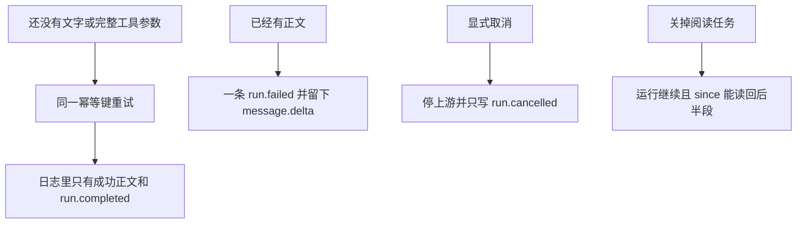

# 异常测试设计

异常测试是一套不打真实模型的验收。模型和工具按剧本回答，一次只注入一种故障，然后核对事件日志、调用次数和上游是否被关掉。它验收已经定下的失败路径。

依据：

- [Sema：流打开前才重试](https://sema-lang.com/docs/llm/resilience)
- [LiveKit：元数据仍可重试](https://github.com/livekit/agents/blob/a527e385/tests/test_inference_llm_retry.py)
- [flatkey：可见输出前后的失败模式](https://flatkey.ai/blog/streaming-ai-api-reliability)
- [heym：客户端停读之后运行仍完成](https://github.com/heymrun/heym/blob/1267b7b6/backend/tests/test_stream_execution_disconnect.py)
- [pytest-stream-lifecycle：服务还在跑时断言清理](https://pypi.org/project/pytest-stream-lifecycle/)
- [Compile N Run：脚本化模型](https://www.compilenrun.com/docs/ai/agents/agents-evaluation-and-testing/agents-mocking-llm-calls/)

## 概念

第 9 步把内存 Store、循环和模型策略接在一起验收。每条用例固定其余剧本，只改一个条件。断言落在四样东西上：事件类型序列和 `seq`、模型调用次数与幂等键、工具实际执行次数、上游是否被取消信号关掉。

终态只有 `run.completed`、`run.failed`、`run.cancelled`。循环退出时日志里还没有终态，应补上 `code` 为 `incomplete-stream` 的 `run.failed`。订阅断开不补这条。约定见 `docs/12-收尾设计.md`。

可见内容只算文字和工具参数。保活帧和用量不算。失败分类和 `model.failed` 的字段见 `docs/04-StreamingModel设计.md`。循环怎么把工具异常收成 `tool.result` 见 `docs/07-AgentLoop与工具注册设计.md`。

## 它解决什么

- 重试边界容易测错。只断言最后一段文字时，保活会被当成已经有内容，或者正文已经交出后又换了一家。
- 取消和订阅断开在 TCP 上看起来一样。验收要分别看到上游被关掉，以及 run 仍在写日志。
- 工具抛错如果被写成 `run.failed`，模型就看不到这次失败，也无法改参数再试。
- 半截流若被记成 `run.completed`，客户端会把没写完的回答当成最终结果。
- 真实供应商的延迟和措辞会让同一条故障时而通过、时而失败。这套验收把模型换成剧本，失败可以复现。

回答好不好、接真实供应商的检查另成一套，不放进第 9 步。

## 设计

HTTP 回放 `GET /events?since=` 留到第 10 步。这一步直接读 Store 的 `since`。真实供应商、进程崩溃后的检查点、人工确认不进这套。

四条路径分开验收。还没有文字或完整工具参数时，用同一把幂等键重试，日志里只留下成功正文和 `run.completed`。已经有正文时不再开下一次调用，留下 `message.delta` 和一条 `run.failed`，不把半截回答拼进下一次提示词。显式取消停上游，只写 `run.cancelled`。关掉阅读任务不停止运行，后半段用 `since` 读回。



| 用例 | 注入 | 通过条件 |
| --- | --- | --- |
| 可见内容前可重试 | 同一调用先两次 503，第三次给出正文 | 三次请求同一幂等键；日志里只有成功正文和 `run.completed` |
| 保活不算可见内容 | 只吐保活或用量，始终没有文字和工具参数 | 仍走重试或首 token 超时；工具执行次数为 0 |
| 不可重试立即失败 | 400，或 `content_filter` | 只打一次；`run.failed`，`retryable` 为假 |
| 已有正文后失败 | 先交出 `text.delta`，再断开上游 | 恰好一次调用；已有 `message.delta` 还在；一条 `run.failed`，阶段为 `after_content` |
| 半截工具参数 | 参数 JSON 未闭合就断流 | 不产生 `tool_call`，工具执行次数为 0 |
| 已有正文后不续 | 已有正文、失败可重试、还没有写工具 | 恰好一次调用；一条 `run.failed`，留下 `message.delta`；不把半截正文拼进下一次请求 |
| 写工具之后不再续 | 写工具已返回，随后模型流失败 | 工具只执行一次；不再自动发起下一次模型调用 |
| 工具失败继续 | 未注册的名字，或处理函数抛异常 | `tool.result` 的 `ok` 为假；下一次模型请求里能按 `call_id` 看到该结果；剧本给了收尾正文时，终态是 `run.completed` |
| 显式取消 | 正文中途 `request_cancel` | 上游停止读取；终态只有 `run.cancelled`；没有 `model.failed`，也没有下一次模型调用 |
| 订阅断开 | 读到第一条增量后关掉阅读端 | 取消信号保持未设置；run 自己走到终态；断开之后的事件用 `since` 还能读到 |
| 补事件 | 记下断开前的 `seq`，终态后再读 | `since` 只返回严格大于该序号的事件，顺序递增 |
| 重复取消 | 终态已是 `cancelled` 再取消一次 | 不再追加第二条 `run.cancelled` |
| 头发出去之前的错误 | 缺消息正文 | HTTP 4xx；Store 里没有这次 run |
| 创建幂等 | 同一 `Idempotency-Key` 再创建一次 | 同一正文回到已有 run；正文不同则 409 |

取消的断言看上游关闭。订阅断开的断言看 run 任务仍在跑，并且之后的事件进了日志。两条都只看本地假上游。假上游停了，不能代替真实供应商已经停计费。断言放在测试进程还活着的时候做；进程退出本身会取消任务，把「断线没停运行」掩盖过去。

同一幂等键的两条用例跟创建接口放在一起测，故障夹具与上表相同。接口的状态码见 `docs/08-创建运行与取消接口设计.md`。

## 实现方式

测试进程里不发网络请求。退避用可控时钟，避免 `Retry-After` 把用例拖到真实等待。剧本用尽仍被继续调用时直接失败，这样循环多打一次不会被静默吞掉。记录每次请求时拷贝当时的消息列表，否则事后看到的全是最终对话。

分成三层，共用同一批故障，替换点不同：

| 层 | 替换什么 | 断言什么 | 放在 |
| --- | --- | --- | --- |
| 策略层 | 供应商字节流 | 尝试次数、幂等键，以及交出的是成功正文还是一条 `model.failed`。取消表现为停止读取 | `tests/model/` |
| 循环层 | 整个 `StreamingModel`，直接产出内部事件 | `RunEvent`、工具执行次数，以及下一次请求里的 `tool.result`。策略已经测过的重试不在这一层重演 | `tests/loop/` |
| 接口层 | 无；走真实 ASGI | 读第一条 SSE 后关掉响应体，服务保持运行，再查 Store。取消走 `POST /cancel`。校验失败停在响应头之前，不创建 run | `tests/api/` |

`events/`、`sse/`、`store/` 里已有的单测仍放在原处。第 9 步不把它们再抄一遍。`since` 的验收走循环写完的那份日志，序号规则仍以内存 Store 为准。阅读端用独立任务表示一个订阅者；关掉的是这个任务，不是 `execute_run`。

第 9 步的完成标准是：可见内容前的失败会按同一幂等键重试；已有正文后只留下 `run.failed` 和原先的 `message.delta`；显式取消会停上游并写下 `run.cancelled`；订阅断开后 Store 里仍有后续事件，并能用 `since` 读回。

## 代码

剧本模型记下每一次调用的幂等键和取消信号。循环层直接驱动它。策略层在它外面再包重试，换成会按次数失败的假字节流。

```python
class ScriptedModel:
    def __init__(self, scripts: list[list[ModelStreamEvent]]) -> None:
        self.scripts = scripts
        self.calls: list[dict] = []

    async def stream(self, messages, *, cancel, idempotency_key):
        if len(self.calls) >= len(self.scripts):
            raise AssertionError("模型调用次数超过剧本")
        self.calls.append(
            {"messages": copy.deepcopy(messages), "key": idempotency_key, "cancel": cancel}
        )
        for event in self.scripts[len(self.calls) - 1]:
            if cancel.is_set():
                return
            yield event
```

已有正文之后失败，日志里应留下增量，并且只有一条失败终态。`TextDelta.delta` 与现有内部事件一致。`ModelFailed` 的字段以 `docs/04-StreamingModel设计.md` 为准。

```python
@pytest.mark.asyncio
async def test_failure_after_visible_text_keeps_delta() -> None:
    model = ScriptedModel([[
        TextDelta(delta="今天"),
        ModelFailed(code="timeout", message="上游中断", retryable=True, phase="after_content"),
    ]])
    store = MemoryStore()
    store.create_run("th_1", "run_1")
    await execute_run(store, model, tools, "run_1")

    events = store.since("run_1", 0)
    deltas = [event for event in events if event.type == "message.delta"]
    assert len(deltas) == 1
    assert events[-1].type == "run.failed"
    assert len(model.calls) == 1
```

订阅断开只结束阅读。运行任务继续，后半段靠 `since` 读回。

```python
@pytest.mark.asyncio
async def test_subscriber_disconnect_leaves_the_run_going() -> None:
    release = asyncio.Event()
    model = GatedModel(release)  # 交出第一段文字后停在 release 上
    store = MemoryStore()
    store.create_run("th_1", "run_1")
    run_task = asyncio.create_task(execute_run(store, model, tools, "run_1"))

    first = await wait_for_type(store, "run_1", "message.delta")
    watch.cancel()  # 只取消订阅任务
    assert not model.cancel.is_set()

    release.set()
    await run_task
    tail = store.since("run_1", first.seq)
    assert tail[-1].type == "run.completed"
```

对应关系：

- `ScriptedModel` 在取消信号已设置时停止产出，不另交一条 `model.failed`。显式取消的用例因此只看到 `run.cancelled`。
- 工具处理函数抛出异常时，断言一条 `ok` 为假的 `tool.result`，以及下一次 `model.calls` 的消息里含有同一个 `call_id`。
- `since` 的参数是已经看到的序号。返回的事件都严格大于它。终态之后再 `append` 会失败，这条由现有 Store 单测覆盖，总验收只确认循环写完后的日志仍能这样读。
