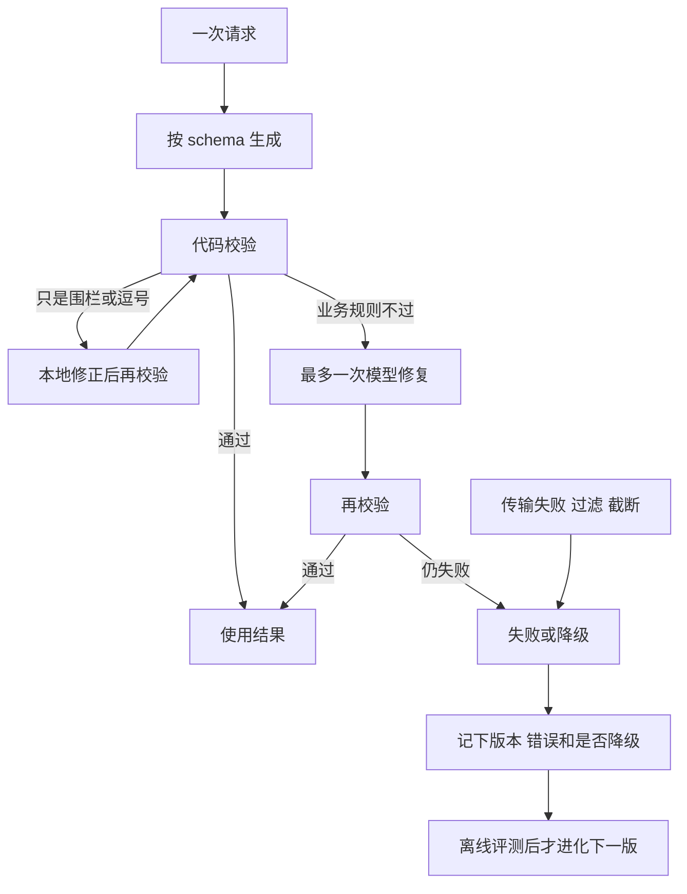

# 结构化输出与失败路径

原生结构化输出、自进化、修复、失败处理和降级发生在不同时机。一次请求里，原生结构化输出先把形状定死；校验不过才修复；修不好就按失败类型结束，或降级成一个明确更弱的结果。自进化不在这条请求路径上，它用积累下来的失败去产生下一版提示词。版本怎么留，见 `docs/13-Prompt工程化管理.md`。

依据：

- [OpenAI：Structured Outputs](https://developers.openai.com/api/docs/guides/structured-outputs)
- [Together：结构化输出与 JSON mode](https://docs.together.ai/learn/structured-outputs)
- [Amazon Nova：约束解码](https://aws.amazon.com/blogs/machine-learning/structured-outputs-with-amazon-nova-a-guide-for-builders/)
- [格式限制对推理的影响](https://arxiv.org/abs/2408.02442)
- [Promptbreeder](https://arxiv.org/abs/2309.16797)
- [Self-Refine](https://proceedings.neurips.cc/paper_files/paper/2023/hash/91edff07232fb1b55a505a9e9f6c0ff3-Abstract.html)
- [复合系统里的 Prompt 优化何时有用](https://arxiv.org/html/2604.14585)
- [优化头寸：知识、截断与协议](https://arxiv.org/abs/2611.01135v1)
- [结构化输出的校验、修复与降级](https://matheuspalma.com/blog/structured-llm-output-validation-repair-loops-production)
- [修复与回退要分开测](https://qaskills.sh/blog/testing-structured-output-repair-fallback)
- [重试预算用尽之后](https://tianpan.co/blog/2026/04/28/structured-output-retry-loop-hidden-compute-waste)

## 原生结构化输出

供应商在采样时按 JSON Schema 屏蔽非法 token，模型写不出不符合该 schema 的已完成输出。工具调用用的是同一套约束。OpenAI 的 Structured Outputs 保证完成且未拒绝的输出遵守给出的 schema。JSON mode 只保证是合法 JSON，不保证字段、类型和枚举。用提示词写「只返回 JSON」则两样都不保证。

它解决的是下游解析：Markdown 围栏、缺字段、字符串和数字混用、枚举写成自造词。这些一进下一步就会在远离模型的地方爆掉。

有价值的场景是结果要被程序消费：抽取字段、用枚举做路由或分类、按字段渲染界面、填写工具参数。这个网关里的工具 `input_schema` 已经是这种契约，执行前会校验。最终回答仍是自由文本。只有当某次 run 的成品必须是结构，才把原生结构化输出放进那一版提示词。

约束只保证形状。内容仍可能是编出来的。跨字段规则（结束日早于开始日、数字必须来自原文）schema 表达不了，还是要在代码里查。分类枚举如果没有出口，模型会被迫选一个错项。Together 的说明建议留一个明确的「其他」。推理任务里，把答案字段放在理由前面会压掉思考。Tam 等人的格式限制实验里，JSON mode 因此明显差于「先写理由」的提示。OpenAI 也要求调用方单独处理拒绝、输出被截断和接口错误。

本项目已有的约定与此一致：严格 JSON Schema 走非流式。见 `docs/01-设计说明.md`。

## 自进化

自进化是离线搜索：另一轮模型或搜索过程改写指令、示例，在固定评测集上打分，留下更好的那一版。常见做法：

| 做法 | 改什么 | 依据什么留下 |
| --- | --- | --- |
| Promptbreeder | 一组任务提示，以及用来变异它们的提示 | 训练集上的适应度 |
| OPRO | 一条指令 | 历史分数 |
| DSPy | 多步流程里的指令和示例 | 程序化指标 |
| GEPA | 根据执行痕迹改写指令 | 分数和文字反馈 |

它解决的是手改提示词覆盖不到的措辞空间，并且把「哪一版更好」绑在指标上。产物仍是一份要评审、要固定版本的提示词，权重不变。胜出的一版按 `docs/13-Prompt工程化管理.md` 写入，不自动替换正在使用的版本。

Self-Refine 是另一件事：同一次请求里生成、自评、再改这一份答案。延迟留在线上，改进不自动变成下一版提示词。

值得用的条件要同时成立：任务会反复跑，指标可信，有优化器看不见的保留集，而且失败属于「模型做得到这种格式，只是默认不这么写」。一份对复合系统的诊断里，六种方法在四个任务上接近抛硬币，唯一稳定变好的任务正是这种格式缺口。他们用的便宜检验是先生成 10 到 20 个候选；最好的一个如果比零样本高不出大约 2 分，就不必继续烧搜索。这个 2 分阈值来自那次实验的设置，换任务要重测，不能当成通用分数线。

另一份对强推理模型的测量把空间分成三类：

| 头寸 | 搜索能不能补上 |
| --- | --- |
| 协议和格式：模型做得到，默认不这么写 | 可以 |
| 知识不在权重里 | 不可以，改检索或换模型 |
| 输出被 token 上限截断 | 不可以，放宽长度或换容量 |

指标只检查格式时，进化出来的会是格式正确、内容错误的提示词。换模型后要重新搜，不能只把旧提示词拿去评一次。小开发集上胜出的程序，放到保留集上可能差于更简单的版本。

## 修复

修复是「这一次输出形状或业务规则不对」之后的有界纠正。它和传输重试分开：429、超时、连接断开时，往往还没有一份可修正的文档。

| 层 | 做什么 | 额外模型调用 |
| --- | --- | --- |
| 本地修正 | 去掉 \`\`\`json 围栏、补上明显的括号或逗号，然后再校验 | 无 |
| 模型修复 | 把校验错误和坏输出交回去，只要求改失败的字段 | 通常 1 次 |

模型修复有价值的地方，是原生约束覆盖不到的规则：字段之间的关系、禁止占位符、数字必须能在输入里找到。校验器能指出具体字段时，一次修复的成功率高。次数、token 和延迟都封顶。修不好就进入失败或降级。两次之后还不行，多半是提示词或 schema 本身有问题，继续重试只增加费用。

允许的转移要先写死：

| 当前状态 | 看到什么 | 下一步 |
| --- | --- | --- |
| 初次输出 | JSON 合法且过 schema | 成功 |
| 初次输出 | 能认出的围栏包着一份 JSON | 本地修正后再校验 |
| 已解析 | schema 或业务规则不通过 | 一次模型修复 |
| 修复输出 | 校验通过 | 成功，并标成修复过 |
| 修复输出 | 仍然不通过 | 降级或终态失败 |
| 任一次模型调用 | 超时或供应商错误 | 仅当策略把它标成暂时性失败才重试 |
| 已解析的动作 | 未知工具或不安全参数 | 不执行 |

工具参数在本项目里已经有一条修复通道：schema 不合法就不执行，错误文本写回消息，模型在轮数上限内再调用。这适合工具。最终答案的修复是另一条。连接错误或供应商堆栈不塞进修复提示。

本仓库里的 `repair_status` 是另一件事：进程重启后按事件日志把运行状态改回来。见 `docs/11-数据库与checkpoint设计.md`。它不修改模型输出。

## 失败处理

失败处理给每种失败一个确定的下一状态，并限制次数。传输失败、内容被过滤、输出被截断、schema 不合法，策略各不相同。

| 失败 | 处理 |
| --- | --- |
| 还没有可见内容时的 429、超时 | 同一幂等键、同一份原始消息再试，次数和等待有上限 |
| 已经写出文字或工具参数 | 停止这次流，保留已有增量，记为失败 |
| 内容过滤、非法请求 | 不再试 |
| 输出被长度截断 | 结束。半截 JSON 不能交给下一步 |
| schema 或业务规则不通过 | 走修复预算，不走传输重试 |
| 修复预算用尽 | 进入降级或终态失败 |

无上限的「直到合法为止」会把一次格式问题放大成多倍推理费用。预算耗尽后应明确返回部分结果、带原因的失败，或带标记的自由文本。

本网关的模型策略已经覆盖前三行。见 `docs/04-StreamingModel设计.md`、`docs/05-模型网关设计.md`、`docs/10-异常测试设计.md`。Prompt 侧要补上的是后三行，并为每次尝试记下是第几次、哪个字段失败。

## 降级

降级是预算用完之后，返回一个事先定义的更弱结果。调用方能看出它变弱了。

有价值的几种：

- 结构化能力不可用时，改成文字回答，并标明这不是可执行结构。
- 抽取只拿到一部分字段时，返回已有字段，并标上未完成和缺哪些字段。
- 分类或生成失败时，用代码里的固定模板，或进入人工队列。
- 当前模型不支持严格 schema 时，换到支持的模型。换不成就关闭这个结构化功能。
- 备用模型更弱时，缩小 schema 或去掉工具，而不是让它接着写半截 JSON。

把失败伪装成 `category: "other"` 且置信度为 1，会让界面和后续自动化信任一个假结果。工具参数没通过校验时，降级也到此为止，不能执行工具。

本项目已有的模型组切换是供应和可用性降级，而且只发生在第一个可见内容之前。那一层不替代 Prompt 降级。评测时还要记下实际打到的模型。网关静默换模型会让某一版提示词的分数失去意义。

## 和这个项目的关系

工具参数校验、首字节前换路由、过滤和截断不再重试，已经是失败处理。原生结构化输出要等某条提示词的成品必须被程序解析时再加，并走非流式。修复只留给 schema 表达不了的业务规则，每次最多一次。降级要有明确标记。自进化放在评测集和版本之后：先看保留集上有没有格式类的提升空间，有提升才把胜出版当成新的不可变版本，经评审后替换当前使用的那一版。
