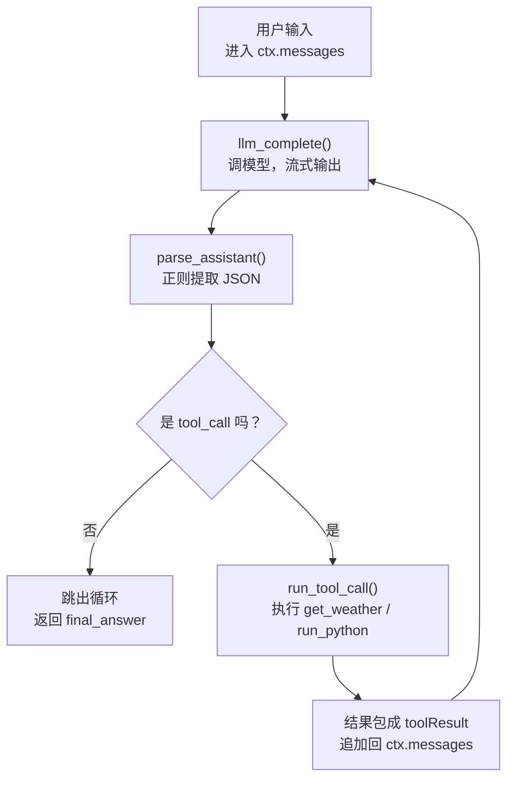

# Week01 1-1：课程导览与首个 Agent Loop

> **资料来源**
>
> - 代码：`course_code/week01/1-1/`（`agent_loop_demo.py`、`sandbox_runner.py`、`eval_runner.py`、`eval_cases.json`）
> - 课件：`course_materials/week01/1-1 开营直播.pptx`（共 13 页）
> - 目录说明：`course_code/week01/README.md`、仓库根 `README.md`
> - 动手练习：`privateNote/Week01/loop/main.py`（复制自 `agent_loop_demo.py`，改用 DashScope）

## 阅读指引

| 部分 | 内容 | 什么时候看 |
| --- | --- | --- |
| **第一部分 学习材料**（A1–A8） | 课件和代码「说了什么」，带原文与代码引用 | 第一次读，建立整体图景 |
| **第二部分 疑问与解答**（Q1–Q14） | 学习中提出的问题、核查过程和结论 | 读材料时遇到卡点 |
| **第三部分 自检与作业**（C1–C3） | 自检题（含我的回答与核查）、v1 改进作业、动手记录 | 学完回来检验 |

行号引用统一写成「文件名:行号」，由项目内 `course-note` skill 的 `check` 脚本校验。

---

# 第一部分 学习材料

## A1 课程定位：开营课的「最小骨架」

### A1.1 课程三条主线

课件第 2 页（`02 OBJECTIVES · Three Pillars`）给整个训练营定了三条主线：

| 主线 | 英文 | 要解决的问题 | 毕业能力 |
| --- | --- | --- | --- |
| 长程任务 | Long-horizon tasks | 让 Agent 在几十步、上百步的链条里保持目标，不会一句话之后跑偏、断链、遗忘 | 拆解真实业务长任务；设计上下文传递与记忆策略；写出可在生产跑多步任务的 Agent |
| Harness | Harness | Prompt 不等于工程。Harness 决定 Agent 在真实环境里能不能稳定跑起来 | 积累适合自己的 Harness；工具调用 / 上下文 / 状态管理分离 |
| 评测 | Evaluation | 没有评测，就没有「更聪明」 | 搭一份 Agent 评测集；跑出 trace + pass-rate 报告；用评测驱动 Harness 迭代 |

`1-1` 的四个文件，就是这三条主线各做一个**最小样本**。它不追求完整，追求的是**让你亲眼看见闭环**。

### A1.2 方法论：不要手写第一版

课件第 9 页（`10 AI-GEN · First Loop`）给了四步节奏：

| 步骤 | 内容 |
| --- | --- |
| STEP 1 · 写需求 | 用一句话写你的任务 + 工具 + 退出条件 |
| STEP 2 · 提交 AI | DeepSeek / Claude / Codex，直接说「请给我 Loop」 |
| STEP 3 · 跑起来 | 本地跑一段、故意造失败、看到 trace |
| STEP 4 · 跑动 ≠ 完成 | 第一版只跑通一个 happy path，进入 Step 2 改善 |

> 别手写 — 写一个 .md 描述，让 AI 把第一版 Loop 吐给你；先跑起来，再迭代。
> —— 课件 slide 9

所以手上这份代码的定位是 **v1 happy path**。它的缺陷是课程故意留的作业，不是作者写砸了（缺陷清单见 C2）。

### A1.3 五层能力进化路径

课件第 4 页（`05 EVOLUTION · 5 Layers (Prompt→Graph)`），副标题 `Observe→Plan→Act→Finalize · Each Layer Solves the Prior Failure Mode`。

**五层定义**

| 层 | 名称 | 课件关键词 | 这一层在回答什么问题 |
| --- | --- | --- | --- |
| 1 | Prompt | 指令基座：Few-shot / 结构化 | 我这一句话问得好不好？ |
| 2 | Context | 可见信息：压缩 / 检索 / 记忆 | 模型这一轮该看到什么？ |
| 3 | Harness | 运行框架：工具 / 状态 / Sandbox | 它能不能安全地动手？ |
| 4 | Loop | 长程迭代 / 失败恢复 | 它怎么自查、纠错、何时停？ |
| 5 | Graph | 多 Agent 协作 / 分支控制流 | 多个 Agent 怎么分工、路由、聚合？ |

**两条贯穿全图的性质**

**性质一：叠加，不是替代。** 课件第 4 页底部注脚：

> `Prompt < Context < Harness < Loop < Graph · additive, not replacement`

做到 Graph 层时，底下四层一个都不能少——每个子 Agent 仍有自己的 Prompt、Context 预算、Harness 和 Loop。

**性质二：驱动力是翻车点，不是任务复杂度。**

> 每一层都在上一层的**工程化翻车点**上长出来——掌握哪一层，就过哪一关。
> —— 课件 slide 4

| 翻车点 | 课件原文症状 | 升级到 |
| --- | --- | --- |
| 第 1 道 | Prompt 写得很漂亮，真任务反复提示 | **Context Engineering**：让 Agent 看到关键、按需检索 |
| 第 2 道 | 工具 + 上下文都堆上，Agent 还是乱跑、不可恢复 | **Harness · Loop**：状态机、Checkpoint、Sandbox、错误恢复 |
| 第 3 道 | 单 Agent 角色冲突，复杂任务**注意力稀释** | **Graph Engineering**：多 Agent · 分支 · 并行 · 结果聚合 |

第 2 道翻车点由 **Harness 和 Loop 一起**解决，这两层在课件里是一组。

**外部佐证：这不是课程原创**

这套分层是 2026 年业界正在收敛的分类法，多个独立来源的层名与顺序与课件一致：

| 来源 | 层序 | 关键印证 |
| --- | --- | --- |
| [The Engineering Stack（白皮书）](https://edabel.co.uk/publications/TheEngineeringStack.pdf) | Prompt → Context → Harness → Loop → Graph | *"Each layer wraps the previous one rather than replacing it: a loop still needs prompts, a harness still needs context, and graphs are built from loops which are built from prompts."* |
| [5-Layer Taxonomy](https://github.com/lamhotsiagian/graph-engineering-project) | Prompt → Context → Harness → Loop → Graph | *"You do not 'graduate' from one layer to the next — you add a layer **only** when the layer below it exhibits a named, observable failure mode."* |
| [Learn Harness Engineering · Lecture 14](https://walkinglabs.github.io/learn-harness-engineering/en/lectures/lecture-14-graph-engineering/) | Prompt → Context → Loop → Graph（四层，Harness 另算） | *"At the graph layer, prompt, context, and loop all survive: every node carries its own prompt, its own context, its own tools, its own memory, its own loop."* |

- Loop 的学术根是 **ReAct（ICLR 2023）** 的 reason-act-observe 循环。「loop engineering」这个词 2026 年 6 月才由 Google 的 Addy Osmani 推广开（综合 Anthropic 的 Boris Cherny 与 OpenClaw 的 Peter Steinberger 的公开说法）。
- 课件的 `Observe → Plan → Act → Finalize` 是 ReAct 同家族的变体，比原版多了显式的 Plan 和 Finalize。

**Harness 有两个尺度**

读外部材料时必须切换尺度，否则会直接撞车。

| 尺度 | Harness 指什么 | 代表来源 |
| --- | --- | --- |
| **宽义** | 模型之外的**一切运行时**：agent loop、context 管理、工具接口、控制机制 | [LangChain](https://www.langchain.com/blog/the-anatomy-of-an-agent-harness)、[Google Cloud](https://cloud.google.com/discover/agent-harness)、[arXiv 2606.10106](https://arxiv.org/html/2606.10106)、Wikipedia |
| **窄义** | 五层里的**第 3 层**，只指工具 / 状态 / Sandbox | 本课程、五层分类法 |

> **Agent = Model + Harness.** If you're not the model, you're the harness.
> —— LangChain, *The Anatomy of an Agent Harness*

**两条学习路径**

课件第 5 页（`06 LEARNING-PATHS · Two Tracks`）。五层图是 **Path A 的视角**：

| 路径 | 走法 | 目标 |
| --- | --- | --- |
| **Path A · 能力纵深** | 从 Prompt 到 Graph Engineering，沿五层往上爬 | 让 Agent 越「聪明」 |
| **Path B · 工程纵深** | 围绕 Loop 不断迭代（Loop 自治 · Eval & Replay） | 让 Agent 越「靠谱」，产出物 = Agent Engineering Platform |

`1-1` 站在第 3～4 层的入口：Harness 三件套有雏形，Loop 跑通了 happy path 但缺失败恢复，正好是 Path B 的起点。

---

## A2 代码地图与主流程

### A2.1 文件

| 文件 | 行数 | 角色 | 对应主线 |
| --- | --- | --- | --- |
| `agent_loop_demo.py` | 303 | Agent Loop 主体 + 两个工具 | Harness |
| `sandbox_runner.py` | 68 | 代码执行与错误分类 | Harness（执行边界） |
| `eval_runner.py` | 75 | 评测执行器，输出 pass rate | 评测 |
| `eval_cases.json` | 18 | 2 条测试用例 | 评测 |

### A2.2 流程图



### A2.3 循环主体与五个步骤

`agent_loop_demo.py:218-278`，注释里标了 Step 1～Step 4：

```python
    while True:
        # Step 1. 调 LLM，让模型决定当前是直接回答还是先调工具。
        on_text_delta = stream_to_terminal if verbose else None
        if verbose:
            print("[assistant_stream]", end=" ", flush=True)
        raw_text = await llm_complete(ctx["messages"], on_text_delta=on_text_delta)
        if verbose:
            print()
        assistant = parse_assistant(raw_text)
        ctx["messages"].append(assistant)
        calls = [block for block in assistant["content"] if block["type"] == "toolCall"]
        if verbose:
            if calls:
                print("[message_end]", render(assistant))
            else:
                print("[message_end] assistant streamed")

        # Step 2. 从 assistant message 里找出 toolCall。
        if not calls:
            break

        # Step 3. 真正执行工具。
        for call in calls:
            tool_meta = ctx["tools"][call["name"]]
            executed_calls.append(
                {
                    "id": call["id"],
                    "name": call["name"],
                    "arguments": call["arguments"],
                    "sandboxed": tool_meta["sandboxed"],
                }
            )
            if verbose:
                print("[tool_start]", call["name"], call["arguments"])
            result = await run_tool_call(call, ctx["tools"])
            tool_results.append(
                {
                    "tool_call_id": call["id"],
                    "tool_name": call["name"],
                    "details": result["details"],
                }
            )
            if verbose:
                print("[tool_end]", result["details"])

            # Step 4. 把 tool result 回填到上下文，供下一轮模型继续使用。
            tool_result = {
                "role": "toolResult",
                "tool_call_id": call["id"],
                "tool_name": call["name"],
                "content": result["content"],
                "details": result["details"],
                "is_error": not result["details"].get("ok", True),
            }
            ctx["messages"].append(tool_result)
            if verbose:
                print("[message_end]", render(tool_result))

        if verbose:
            print("[turn_end]")
            print("[turn_start]")
```

函数文档字符串（`agent_loop_demo.py:190-195`）写的五步，和 `while` 里注释的 Step 1～4 **不是同一套编号**。注释把「调模型」标成 Step 1，把「没有 toolCall 就 break」标成 Step 2。以文档字符串的五步为准，行号以循环里的实际动作为准：

| 步骤 | 做什么 | 行号 |
| --- | --- | --- |
| 1 | 用户消息进入上下文。在 `while` 之前，只做一次 | 第 201 行 |
| 2 | 把现有 `ctx["messages"]` 发给模型，解析成 `assistant` 并追加 | 第 223–227 行 |
| 3 | 从这条 `assistant` 里筛 `toolCall`。没有就 `break`；有就执行工具 | 判断在第 228、236–237 行；执行在第 240–252 行 |
| 4 | 把 `toolResult` 追加回 `ctx["messages"]`，供下一轮模型使用 | 第 264–272 行 |
| 5 | 回到第 2 步，直到某次模型不再请求工具 | `while True` 在第 218 行，出口是第 236–237 行的 `break` |

循环结束后，第 280 行 `render(ctx["messages"][-1])` 才取出最终回答，它不属于这五步。

### A2.4 上下文容器 ctx

`agent_loop_demo.py:200-212`。它叫**上下文容器**，里面装的是要喂给模型的东西：

```python
    ctx = {
        "messages": [{"role": "user", "content": [{"type": "text", "text": user_text}]}],
        "tools": {
            "get_weather": {
                "handler": get_weather,
                "sandboxed": False,
            },
            "run_python": {
                "handler": run_python_tool,
                "sandboxed": True,
            },
        },
    }
```

`sandboxed` 字段现在只是被记录进 `executed_calls`，没有真正改变执行路径，是为 Week 03 的执行边界治理预留的槽位。

真正充当「状态」的是 `agent_loop()` 里三个局部变量（`agent_loop_demo.py:197-199`），见 Q3：

```python
    started_at = time.perf_counter()
    executed_calls = []
    tool_results = []
```

---

## A3 关键设计

### A3.1 工具调用是「文本协议」，不是原生 Function Calling

**工具规则全部写在 system prompt 里**（`agent_loop_demo.py:21-26`）：

```python
SYSTEM = (
    "你是会使用工具的助手。"
    '问天气时，若还没有结果，只输出 JSON：{"type":"tool_call","name":"get_weather","arguments":{"city":"城市名"}}；'
    '当用户要求执行一小段 Python 代码、做计算或验证结果时，若还没有结果，只输出 JSON：{"type":"tool_call","name":"run_python","arguments":{"code":"Python代码"}}；'
    "拿到工具结果后再自然语言回答。"
)
```

**解析在 `parse_assistant()`**（`agent_loop_demo.py:99-126`），是「代码识别模型是否决定调用工具」的唯一位置：

```python
def parse_assistant(text: str) -> dict:
    """
    把模型输出解析成统一的 assistant message。

    这里是"代码识别模型是否决定调用工具"的地方：
    - 如果模型输出的是 {"type":"tool_call", ...}
    - 我们就把它转成内部的 toolCall block
    - 否则就按普通文本回答处理
    """
    try:
        match = re.search(r"\{.*\}", text, re.S)
        payload = json.loads(match.group(0)) if match else {}
        if payload.get("type") == "tool_call":
            return {
                "role": "assistant",
                "content": [
                    {
                        "type": "toolCall",
                        "id": "call_001",
                        "name": payload["name"],
                        "arguments": payload["arguments"],
                    }
                ],
            }
    except Exception:
        pass

    return {"role": "assistant", "content": [{"type": "text", "text": text}]}
```

这是教学上的刻意简化：工具调用本质就是**双方约定的一段文本格式**，没有魔法。原生 Function Calling 在 Week 02 才讲。

### A3.2 内部消息格式 ≠ LLM 消息格式

内部统一用 block 结构 `content: [{type: "text" | "toolCall"}]`，由 `render()` 和 `to_llm()` 转换（`agent_loop_demo.py:67-96`）：

```python
def render(message: dict) -> str:
    """把内部 message 结构渲染成可读文本。"""
    parts = []
    for block in message["content"]:
        if block["type"] == "text":
            parts.append(block["text"])
        elif block["type"] == "toolCall":
            parts.append(
                f'[toolCall] {block["name"]}({json.dumps(block["arguments"], ensure_ascii=False)})'
            )
    return "\n".join(parts)


def to_llm(messages: list[dict]) -> list[dict]:
    """把内部消息格式转成 LLM 输入格式。"""
    out = []
    for message in messages:
        if message["role"] in {"user", "assistant"}:
            out.append({"role": message["role"], "content": render(message)})
        elif message["role"] == "toolResult":
            out.append(
                {
                    "role": "user",
                    "content": (
                        f'Tool result for {message["tool_name"]}: '
                        f'{json.dumps(message["details"], ensure_ascii=False)}'
                    ),
                }
            )
    return out
```

「两套格式 + 一层适配」的习惯，就是后面 **Model Adapter**（1-2 的 `modelAdapter.py` / `OpenAIAdapter.py` / `dsAdapter.py`）和 **LLM Gateway**（1-6 / 1-7）的雏形。

`toolResult` 被降级成 `role: "user"`，而不是 OpenAI 协议里的 `role: "tool"`，因为 A3.1 没走原生 Function Calling，没有 `tool_call_id` 可以挂。role 的完整分工见 Q5。

### A3.3 异步与流式

**`llm_complete`**（`agent_loop_demo.py:157-177`）：

```python
async def llm_complete(messages: list[dict], on_text_delta=None) -> str:
    """
    调用 DeepSeek。

    这里是"模型真正做决策"的地方：
    模型会根据 system prompt + 当前上下文，
    决定这次是直接回答，还是先返回 tool_call JSON。
    """

    def _call() -> str:
        response = client.chat.completions.create(
            model="deepseek-v4-flash",
            messages=[{"role": "system", "content": SYSTEM}, *to_llm(messages)],
            stream=True,
            reasoning_effort="low",
            extra_body={"thinking": {"type": "disabled"}},
        )
        return extract_response_text(response, on_text_delta=on_text_delta)

    # OpenAI SDK 是阻塞式的，所以放在线程里跑，避免卡住 asyncio。
    return await asyncio.to_thread(_call)
```

`model="deepseek-v4-flash"` 对应课件第 8 页（`09 TECH-STACK · AI-native 3-piece`）的选型：**「Agent 跑的不是 35 道工程题，是 35 步短推理——速度和性价比，关注度首次超过绝对智力」**。源码注释「OpenAI SDK 是阻塞式的」说得过宽，准确说法见 Q12。两个思考参数的实际效果见 A7 与 Q13。

**`extract_response_text`**（`agent_loop_demo.py:129-148`）兼容两种返回形态：

```python
def extract_response_text(response, on_text_delta=None) -> str:
    """兼容普通响应与 stream=True 的分片响应，并支持边收边消费文本分片。"""
    if hasattr(response, "choices"):
        text = response.choices[0].message.content or ""
        if text and on_text_delta:
            on_text_delta(text)
        return text

    chunks: list[str] = []
    for chunk in response:
        if not getattr(chunk, "choices", None):
            continue

        delta = chunk.choices[0].delta
        if delta and delta.content:
            chunks.append(delta.content)
            if on_text_delta:
                on_text_delta(delta.content)

    return "".join(chunks)
```

流式协议本身（SSE、取消、重放、Checkpoint）在 **1-3**。

---

## A4 sandbox_runner

### A4.1 实现

`sandbox_runner.py:9-68`：

```python
async def run_python_in_sandbox(code: str, timeout_sec: int = 3) -> dict:
    """在临时目录中执行一段 Python 代码，并返回最小结构化结果。"""

    def _run() -> dict:
        start = time.perf_counter()

        with tempfile.TemporaryDirectory() as tmpdir:
            script_path = Path(tmpdir) / "main.py"
            script_path.write_text(code, encoding="utf-8")

            try:
                proc = subprocess.run(
                    [sys.executable, str(script_path)],
                    cwd=tmpdir,
                    capture_output=True,
                    text=True,
                    timeout=timeout_sec,
                    env={"PYTHONIOENCODING": "utf-8"},
                )
                duration_ms = int((time.perf_counter() - start) * 1000)
                stderr = proc.stderr.strip()
                if proc.returncode == 0:
                    error_type = None
                    error_message = ""
                elif "SyntaxError" in stderr:
                    error_type = "syntax_error"
                    error_message = "Python 代码存在语法错误。"
                else:
                    error_type = "runtime_error"
                    error_message = "Python 代码运行时抛出了异常。"
                return {
                    "ok": proc.returncode == 0,
                    "exit_code": proc.returncode,
                    "stdout": proc.stdout,
                    "stderr": proc.stderr,
                    "error_type": error_type,
                    "error_message": error_message,
                    "duration_ms": duration_ms,
                    "sandbox": {
                        "cwd": tmpdir,
                        "timeout_sec": timeout_sec,
                    },
                }
            except subprocess.TimeoutExpired:
                # ...（返回 error_type="timeout" 的同构字典）

    return await asyncio.to_thread(_run)
```

它的价值是把执行结果规整成**结构化字典**，并把失败分成三类：`syntax_error` / `runtime_error` / `timeout`。「错误要分类，而不是只抛异常」的思路，1-2 的 `normalize_exception.py` 会继续展开。

### A4.2 隔离了什么

把脚本放进临时目录，不等于隔离了执行资源。进程用的仍是宿主机的 CPU、内存、网络和文件系统权限。

| 维度 | 是否隔离 | 说明 |
| --- | --- | --- |
| 工作目录 | 只换了位置 | `TemporaryDirectory()` 作为 `cwd`，脚本写成 `main.py`，函数返回后目录删除。代码仍可读写目录以外的路径 |
| 执行时长 | ✅ | `timeout=3`，超时归类为 `timeout` |
| 环境变量 | 部分 | `env={"PYTHONIOENCODING": "utf-8"}` 替换了整个环境，父进程变量不会传进去。这不是 CPU 或内存配额 |
| 文件系统 | ❌ | 没有 chroot、挂载命名空间或容器根文件系统 |
| 网络 | ❌ | 没有网络命名空间，也没有域名白名单 |
| CPU / 内存 | ❌ | 没有 cgroup 一类的限制 |
| 进程与用户 | ❌ | 跑在宿主机进程里，用当前用户和 `sys.executable` |

真正的执行边界（pi-sandbox / OpenSandbox）是 **Week 03** 的内容，对照见 Q4。

### A4.3 结果如何喂回模型

`agent_loop_demo.py:43-64`。成功和失败走不同措辞的自然语言，目的是让模型读懂错误并自我纠正：

```python
async def run_python_tool(args: dict) -> dict:
    """把一小段 Python 代码交给最小 sandbox 执行。"""
    code = args.get("code", "")
    result = await run_python_in_sandbox(code)
    stdout_text = result["stdout"].strip()
    stderr_text = result["stderr"].strip()
    if result["ok"]:
        output_text = (
            "Python 执行成功。\n"
            f"输出:\n{stdout_text or 'No output.'}"
        )
    else:
        detail_text = stderr_text or "No stderr."
        output_text = (
            f"Python 执行失败（{result['error_type']}）。\n"
            f"说明: {result['error_message']}\n"
            f"错误详情:\n{detail_text}"
        )
    return {
        "content": [{"type": "text", "text": output_text}],
        "details": result,
    }
```

---

## A5 评测：最朴素的断言式 Eval

### A5.1 用例定义

`eval_cases.json` 全文：

```json
[
  {
    "input": "北京现在天气怎么样？",
    "expect_tool": "get_weather",
    "expect_arguments": {
      "city": "北京"
    },
    "expect_answer_contains": ["北京", "晴"]
  },
  {
    "input": "请用 Python 计算 12 * 12，只给我结果。",
    "expect_tool": "run_python",
    "expect_arguments_contains": {
      "code": ["12", "12", "*"]
    },
    "expect_answer_contains": ["144"]
  }
]
```

两种参数断言：

- `expect_arguments`：**精确匹配**，适合枚举型参数（城市名）
- `expect_arguments_contains`：**包含匹配**，适合自由文本参数（生成的代码，写法不唯一）

### A5.2 断言拆成三个维度

`eval_runner.py:34-71`：

```python
async def main() -> None:
    cases = load_cases()
    passed = 0
    total = len(cases)

    for idx, case in enumerate(cases, start=1):
        result = await agent_loop(case["input"], verbose=False)
        tool_calls = result["tool_calls"]
        used_tools = [call["name"] for call in tool_calls]
        answer = result["final_answer"]

        matched_call = find_matching_tool_call(tool_calls, case["expect_tool"])
        tool_ok = matched_call is not None
        args_ok = tool_ok
        if matched_call and "expect_arguments" in case:
            args_ok = args_ok and arguments_match_exact(
                matched_call, case["expect_arguments"]
            )
        if matched_call and "expect_arguments_contains" in case:
            args_ok = args_ok and arguments_match_contains(
                matched_call, case["expect_arguments_contains"]
            )
        answer_ok = all(word in answer for word in case["expect_answer_contains"])
        ok = tool_ok and args_ok and answer_ok
        if ok:
            passed += 1

        print(
            f"[case {idx}] ok={ok} "
            f"tool_ok={tool_ok} args_ok={args_ok} answer_ok={answer_ok} "
            f"tools={used_tools} duration_ms={result['duration_ms']}"
        )
        print(f"  input: {case['input']}")
        if matched_call:
            print(f"  matched_call: {matched_call}")
        print(f"  answer: {answer}")

    print(f"\nPass rate: {passed}/{total}")
```

| 维度 | 含义 | 失败说明什么 |
| --- | --- | --- |
| `tool_ok` | 有没有调对工具 | 模型的**路由判断**错了，改 system prompt |
| `args_ok` | 参数对不对 | 模型的**参数抽取**错了，加 few-shot 或 schema 约束 |
| `answer_ok` | 最终答案含不含关键词 | 工具调对了，但**总结环节**掉链子 |

三维拆分的价值：笼统的 `pass/fail` 没法指导你改哪里，拆开之后失败直接指向要修的环节。

### A5.3 运行方式

```bash
cd course_code/week01/1-1
export DEEPSEEK_API_KEY=...   # 或由 .env / direnv 注入
python eval_runner.py
```

`eval_runner.py` 用 `from agent_loop_demo import agent_loop`，而 `agent_loop_demo.py` 又 `from sandbox_runner import ...`，所以**必须在 `1-1` 目录下执行**。用例文件靠 `Path(__file__).with_name("eval_cases.json")` 定位，不依赖当前工作目录。

---

## A6 前沿工具怎么处理同一件事

Claude Code、Cursor、Codex 的循环和 `1-1` 同形：模型返回工具调用，宿主执行，结果追加进历史，直到不再要工具。工具注册没有取代 Loop，也没有让历史自动消失。差在宿主多做了四件事：

| 宿主做的事 | Claude Code | Codex | Cursor |
| --- | --- | --- | --- |
| `tools` 与历史分离 | 每轮带工具定义；MCP 默认只放工具名，要用时再加载 schema | `tools` 含 CLI 工具、Responses API 工具、MCP 工具；顺序必须稳定，否则前缀缓存失效 | 按模型换工具形状：OpenAI 用 patch，Anthropic 用字符串替换 |
| 长工具输出 | 单条结果有预算，过大时换成引用 | 调用和结果留在 `input` 里，靠后面的压缩腾位置 | 长命令和 MCP 结果写进文件，上下文里只留引用 |
| 历史快满 | 自动 compact：总结较早对话，留下最近几轮 | 超过 `auto_compact_limit` 时调用 `/responses/compact`，用更短的 item 列表替换 `input`，其中有一条不透明的 `type=compaction` | 会话变长后做摘要 |
| 规则放在历史外面 | `CLAUDE.md` 压缩后从磁盘重新注入，并重读本会话最近改过的文件（最多五个） | 开发者指令和 sandbox 说明在 `instructions`，不依赖旧消息还在 | 系统提示、Rules 每轮重放；静态上下文只留操作系统、git status、当前和最近查看的文件 |

来源：[Claude Code agent loop](https://code.claude.com/docs/en/agent-sdk/agent-loop)、[上下文窗口](https://code.claude.com/docs/en/context-window)、[Codex agent loop](https://openai.com/index/unrolling-the-codex-agent-loop/)、[Cursor harness](https://cursor.com/blog/continually-improving-agent-harness)。

一份对 Claude Code 源码的分析还描述了每次请求前的五层递减：单条工具结果预算、裁掉老历史、为缓存做的小压缩、把长历史投影成摘要、最后才做语义总结。官方文档对外讲的是最后这一层自动总结，五层管线不要当成文档里的全部口径。

压缩的是发给模型的那一份，本地通常仍留着完整记录，所以「能继续对话」和「能恢复现场」仍是两件事（见 Q3）。

---

## A7 模型调用参数核对

课程代码用 DeepSeek，核对对象是 [DeepSeek API 文档](https://api-docs.deepseek.com/)。

| 项 | 课程代码 | 文档现状 |
| --- | --- | --- |
| 模型名 | `deepseek-v4-flash` | 2026-07-31 正式发布。2026-09-10 V4.1 Flash 发布后，旧名仍被接受，但对应模型已退役，请求由 V4.1 Flash 处理。文档推荐写 `deepseek-flash` |
| 关思考 | `reasoning_effort="low"` + `thinking: {"type": "disabled"}` | 两个参数矛盾，见下 |
| `temperature` | 未传 | 思考模式下不支持，传了不报错但无效 |
| `top_p` | 未传 | `deepseek-flash` 只在思考模式下生效，有效范围 0.95–1.0；非思考模式固定 1.0，传值被忽略 |

`reasoning_effort` 的取值是 `none` / `low` / `high` / `max`：`none` 关闭思考，`low` / `high` / `max` 都是**启用**，只是强度不同。`thinking` 对象提供时，**优先级高于** `reasoning_effort`。所以课程代码里最终生效的是「关闭思考」，`reasoning_effort="low"` 是死参数。想关思考，留一个开关即可；`thinking` 需放进 `extra_body`，`reasoning_effort="none"` 可直接传。

DashScope（阿里云百炼）兼容模式的写法不同：用 `extra_body={"enable_thinking": False}` 关思考，`base_url="https://dashscope.aliyuncs.com/compatible-mode/v1"`（实测可用）。

---

## A8 关联知识

| 方向 | 去哪一节 |
| --- | --- |
| 模型 API、采样参数、Token 与 Context Window、重试、Model Adapter | `course_code/week01/1-2/` |
| Streaming、SSE、协作式取消、事件重放、Checkpoint | `course_code/week01/1-3/` |
| Prompt 作为行为契约、注入防护、版本管理 | `course_code/week01/1-4/` |
| JSON Schema / Pydantic 三层校验、纠错循环、失败降级 | `course_code/week01/1-5/` |
| LLM Gateway（FastAPI、Provider Adapter、Fallback、Token/Cost/Latency 追踪） | `course_code/week01/1-6/`、`1-7/` |
| 原生 Function Calling、Tool Registry、MCP、工具安全边界 | Week 02 |
| 真正的 Sandbox、状态机、Checkpoint、人工审批恢复、LangGraph 编排 | Week 03 |
| Context Engineering、长期记忆、RAG | Week 04 |

---

# 第二部分 疑问与解答

## Q1 五层演进架构，我的理解对吗？

**我的理解**与课件原文逐层对照：

| 层 | 我的表述 | 课件原文 | 判定 |
| --- | --- | --- | --- |
| 1 Prompt | 针对简单、单次的任务 | 指令基座 · Few-shot · 结构化 | 基本对，措辞偏窄 |
| 2 Context | 针对需要更多上下文信息的任务 | 可见信息 · 压缩 / 检索 / 记忆 | **方向反了** |
| 3 Harness | 针对需要复杂、可控的上下文信息和相关工具的任务 | 运行框架 · 工具 / 状态 / Sandbox | **职责串层** |
| 4 Loop | 需要针对特定目标进行多轮任务 | 长程迭代 · 失败恢复 | 对了一半 |
| 5 Graph | 多个 Agent 协作，并能够进行分支判断 | 多 Agent 协作 · 分支控制流 | 准确 |

层名和顺序都对。需要纠正三处：

**① Context 不是「更多」，是「更少但更准」。** 这一层的动作是压缩、预算、筛选，不是堆料。第 4 周章节描述说得最直白：

> 让 Agent 在长链中"看到关键、遗忘冗余、按需检索"——决定 Agent 上限的不是模型。

[Anthropic 官方定义](https://www.anthropic.com/engineering/effective-context-engineering-for-ai-agents)同向：context engineering 是 *"curating and maintaining the **optimal** set of tokens"*，每一轮都要重新挑出 **smallest high-signal context**。理解成「给更多上下文」，学到预算与压缩策略时会拧着。

**② Harness 管的是执行环境，不是上下文内容。** 课件给 Harness 的是工具 / 状态 / Sandbox。用 `1-1` 代码对照：

| Harness 组成 | 对应代码 | 完成度 |
| --- | --- | --- |
| 工具注册 | `ctx["tools"]` | 有雏形，缺 schema 与校验 |
| 状态 | `ctx["messages"]` + 局部累加器 | **缺位**，见 Q3 |
| 执行隔离 | `sandbox_runner.py` | 有雏形，只限了时长，见 Q4 |

「该把哪些 message 喂给模型、怎么压缩」是第 2 层的职责，对应 `to_llm()`，现在是全量透传，没有任何预算控制。

**③ Loop 不等于「多轮对话」。** Loop 是**长程迭代 + 失败恢复**，内循环 `Observe → Plan → Act → Finalize`。多轮对话只是轮数多；Loop 是 Agent 自己观察结果、判断是否偏离、纠错重试，并且**知道什么时候该停**。退出条件（`max_steps`、预算）和错误恢复是 Loop 的必要组成，不是附加项（见 C2 的 9.1）。

**④ 缺了一条总纲：叠加，不是选择。** 「针对 XX 任务」的写法读起来像按任务复杂度选一层。实际上做 Graph 时底下四层一个都不能少，而且每一层都长在上一层的翻车点上（见 A1.3 的两条性质）。

**修正后的表述**：

```text
1. Prompt   指令基座      Few-shot、结构化输出        —— 让模型听懂要做什么
2. Context  可见信息      压缩、检索、记忆、预算      —— 让模型只看到关键的
3. Harness  运行框架      工具、状态、Sandbox         —— 让执行可控、可隔离
4. Loop     长程迭代      Observe→Plan→Act→Finalize  —— 让它能自己纠错并知道何时停
            失败恢复      退出条件、Checkpoint
5. Graph    多 Agent      分支、并行、结果聚合        —— 让角色分工、避免注意力稀释

性质：additive（叠加），不是 replacement（替代）
驱动：每一层都是上一层翻车点的解法，不是任务复杂度的分档
```

## Q2 Harness 到底包不包含上下文管理？

两边都对，尺度不同。LangChain、Google Cloud、arXiv 论文用**宽义**：Harness 是模型之外的一切运行时，[arXiv 论文](https://arxiv.org/html/2606.10106)列的四个必要条件里就有 *"(iii) **context management** that decides what enters and leaves the model's window"*。本课程用**窄义**：Harness 只是第 3 层，Context 单独拎成第 2 层。两个尺度的对照表见 A1.3。

所以「Harness 包含上下文管理」在宽义下是对的，在本课程的五层分层下是错的。读外部材料时先确认它用哪个尺度。

## Q3 `ctx["messages"]` 算状态吗？Harness 有独立的状态机吗？

**严格说，`ctx["messages"]` 是 context，不是 state；`1-1` 没有独立状态机，Week 03 才补上。**

| | Context | State |
| --- | --- | --- |
| 给谁看 | **模型**看 | **harness 自己**读写判断 |
| 形态 | 文本 / 消息序列，非结构化 | 结构化字段，带类型与枚举 |
| 作用 | 影响模型这一轮的决策 | 决定循环走哪条边、能不能继续、要不要停 |
| 持久化后恢复的是 | 「对话」 | 「现场」 |

**判别方法**：如果某个信息不进 prompt、模型压根看不到，但代码要靠它做分支判断，它就是 state。例如 `revision_count >= max_revisions`，模型不需要知道，harness 必须知道。

`3-3`（State Machine 与 Checkpoint）README 里有一句话是这个区分的标准答案：

> 先用 pi 原生 `--session-dir` / `-c` 验证会话续接，指出"**能继续对话 ≠ 能恢复现场**"

把 messages 存下来再喂回去，模型能接着聊；但「任务走到第几步、哪步失败过、重试了几次、正在等谁审批」这些，messages 里没有，或者有但不可靠（要靠模型自己从文本里重新读出来）。

**`1-1` 里状态散落在函数栈上。** 除了 `ctx["messages"]`，真正在累积信息的是 `agent_loop()` 里的三个局部变量（`agent_loop_demo.py:197-199`）：`started_at`、`executed_calls`、`tool_results`。它们在循环里不断 append，最后拼进返回值，但活在函数栈上：函数一退出就没了，不能持久化、不能恢复，循环中途崩掉全部丢失。这就是课件第 10 页点名的 v1 症状「状态散落」。

**Week 03 的做法。** `course_code/week03/3-6/release_pipeline/demos/05_loops/state.py` 定义了显式的 `ReleaseState`，messages 在里面只是一个字段，注释还标明它仅仅是「ToolNode 通道」：

```python
class ReleaseState(TypedDict):
    # 入口
    ticket_id: str
    service: str
    version: str
    patch_diff: str

    # 循环预算（入口提供）
    revision_count: int
    max_revisions: int
    rollback_count: int
    max_rollbacks: int
    canary_cursor: int

    # ToolNode 通道
    messages: NotRequired[Annotated[list[AnyMessage], add_messages]]
    # checks：replace 语义，每轮 collect_checks 整体覆盖
    checks: NotRequired[list[CheckResult]]
    checks_passed: int
    change_level: NotRequired[Literal["L", "M", "H"]]

    # approvals / metric_samples：add 语义，审计与监控累计
    approvals: NotRequired[Annotated[list[Approval], add]]
    metric_samples: NotRequired[Annotated[list[MetricSample], add]]

    outcome: NotRequired[
        Literal["released", "rejected", "rolled_back", "incomplete"]
    ]
```

| 关注点 | `1-1` 的 `ctx` + 局部变量 | `ReleaseState` |
| --- | --- | --- |
| 循环预算 | 无（`while True`） | `revision_count` / `max_revisions` / `rollback_count` / `max_rollbacks` |
| 当前进度 | 无 | `canary_cursor` / `current_stage` / `stages_completed` |
| 终态 | 无 | `outcome`：released / rejected / rolled_back / incomplete |
| 审批 | 无 | `approvals` 累计，带 `interrupt_id` 与 `actor` |
| 执行记录 | 局部变量 `executed_calls`，函数退出即丢 | `checks` / `metric_samples`，进 state 可持久化 |
| 字段合并语义 | 只有一种：无脑 `append` | 显式声明：`add_messages`（按 id 去重）/ `add`（累计）/ 默认 replace（覆盖） |

最后一行是 `1-1` 完全没有的概念：**不同字段的合并语义是显式声明的**。

**补充**：说「messages 当状态」在最小形态下不算错。LangGraph 的 prebuilt ReAct agent 用的 `MessagesState` 就只有 `messages` 一个字段，这是合法的退化情况。但它有明确天花板：一旦需要 max_steps、预算、审批、断点恢复、多阶段流程中的任何一个，就必须把 state 拆出来显式建模。这也是课件把 Harness 和 Loop 放在同一道翻车点的原因：状态机是它俩的共同前提。

## Q4 `sandbox_runner` 是真实的沙箱吗？返回的 dict 是不是为配合 loop 做的简化？

**进程是真跑的，沙箱不是真的。**

`subprocess.run([sys.executable, script_path], timeout=3)` 在宿主机上启动一个真实的 Python 进程，`stdout`、`stderr`、`exit_code` 都来自这个进程，不是 mock。但它只做了三件事：换临时工作目录、3 秒超时、把环境变量换成只有 `PYTHONIOENCODING`。隔离维度表见 A4.2。

**dict 里哪些是给 loop 用的。** `run_python_tool()` 的控制流只读五个字段：

| 字段 | loop 怎么用 |
| --- | --- |
| `ok` | 决定成功还是失败的自然语言 |
| `stdout` / `stderr` | 拼进给模型看的文本 |
| `error_type` / `error_message` | 失败时告诉模型错在哪一类 |

`exit_code`、`duration_ms`、`sandbox.cwd`、`sandbox.timeout_sec` 不被循环分支使用，只是整份 dict 被原样放进 `details`，再由 `to_llm()` 序列化回给模型。`sandbox.cwd` 包在 `TemporaryDirectory()` 里，函数返回后目录已经删除，调用方拿到的是一条不存在的路径。

**这份 dict 不是沙箱协议。** 工具对外的契约是另一层信封 `{content, details}`：`content` 给模型读，`details` 是原始结构。`get_weather` 的 `details` 是 `{city, weather, temperature_c}`，和这份 dict 形状不同。`error_type` 用 `"SyntaxError" in stderr` 做字符串匹配再配中文说明，那是给模型读的，真实沙箱只负责限制和执行，错误归类应放在工具适配层。

**真实沙箱隔离什么。** `1-1` 限制的是「这次进程跑多久、脚本文件放哪」；真实沙箱限制的是**这次执行能碰到宿主机的哪些东西**。`3-4` 把三层分工写成：Tool Runtime 检查放行，Sandbox 限制影响范围，Harness 组织执行。课程里两个例子：

- **pi-sandbox**：用 `sandbox.json` 规定允许的副作用。验收包括产物可写、受保护文件拒绝写入、未授权域名被阻断。
- **OpenSandbox**：`sandbox_demo.py` 用 Docker 起 `python:3.11-slim` 容器，限制 `cpu: "1"`、`memory: "512Mi"`，在容器里跑命令，读回 `/tmp/result.json`，最后 `kill` 掉容器。验收条件是容器内看不到宿主机上的标记文件，宿主机上的标记文件也没被改。

| 边界 | 真实沙箱做什么 | `sandbox_runner.py` |
| --- | --- | --- |
| 文件系统 | 独立根文件系统。宿主机目录默认不挂进去，只挂明确允许的路径 | 只有 `cwd` 在临时目录，其余路径仍可访问 |
| 网络 | 默认无网络，或只放行白名单域名 | 完全放开 |
| CPU / 内存 | cgroup 配额，超限就杀进程 | 无配额 |
| 进程 | 独立进程空间，看不到宿主机进程；沙箱销毁时进程一起结束 | 宿主机上的普通子进程 |
| 用户与权限 | 非 root、丢掉不需要的 capabilities | 当前用户的全部权限 |
| 时长 | 仍然要有超时。超时是控制，不是隔离本身 | 有 3 秒超时 |

容器也不是绝对隔离：它和宿主机共享内核。沙箱的目标是把一次模型生成代码的爆炸半径限制在容器里，而不是保证任何代码都碰不到内核。OpenSandbox 返回的是容器里的执行日志，不负责把错误分成 `syntax_error` / `runtime_error`，那一层分类留在工具适配器里。

## Q5 脚本里 role 有好几个，除了 system 和 user，实践中有必要吗？

脚本里有四种 role，真正发给模型的只有 `system`、`user`、`assistant` 三种：

| role | 存在于 | 发给模型时 |
| --- | --- | --- |
| `system` | 只在 `llm_complete()` 里临时拼上，不进 `ctx["messages"]` | 原样发送 |
| `user` | `ctx["messages"]`，人的输入 | 原样发送 |
| `assistant` | `ctx["messages"]`，模型上一轮的决定（文本或 `toolCall`） | 原样发送 |
| `toolResult` | `ctx["messages"]`，harness 自己用 | **改写成 `user`** |

**`assistant` 不能去掉。** 它记录的是模型自己上一轮已经做出的决定。第二轮如果只有 `system` 和两条 `user`，模型看不到「这是我刚才请求的工具，结果回来了」，会把工具结果当成用户又说了一句话，常见后果是再调一次同一个工具。模型是按说话人训练的：`user` 是对方的新输入，`assistant` 是自己已经说过的内容。

**`toolResult` 对内必要，对外被这份 demo 藏起来了。** `tool_call_id`、`tool_name`、`is_error` 都是给循环自己用的。如果一开始就存成 `user`，代码分不清「人说的」和「工具返回的」。它出站时被改写成 `user`，是因为这份 demo 没用原生 Function Calling，没有 `tool_call_id` 可以挂到协议里的 `role: "tool"` 上，这是教学妥协，不是实践做法。

**实践里的标准角色**是四个：

| 角色 | 实践中 |
| --- | --- |
| `system` | 要。行为契约，通常每轮都带，不进对话历史也可以 |
| `user` | 要。只放人的输入 |
| `assistant` | 要。放模型上一轮的话，以及它发起的 `tool_calls` |
| `tool` | 用原生工具调用时要。一条结果对应一个 `tool_call_id`，并行调用时靠它配对 |

`tool` 不该合并进 `user`：合并之后，工具输出会被当成用户指令，并行调用时也分不清结果属于哪一次调用。Week 02 的 Function Calling 会改成这条协议。

## Q6 `parse_assistant` 把 `"tool_call"` 改成 `"toolCall"`，意义是什么？

这段代码做的是**协议转换**：模型输出的是一段带 `type: "tool_call"` 的 JSON 文本，`parse_assistant()` 把它拆开，重组成内部消息里的 content block。`role` 两种情况都是 `"assistant"`，变的是 block 的 `type`：需要调用工具时是 `"toolCall"`，不需要时是 `"text"`。

模型输出：

```json
{"type":"tool_call","name":"get_weather","arguments":{"city":"北京"}}
```

函数丢掉外层的 `type`，改成：

```python
{
    "role": "assistant",
    "content": [{
        "type": "toolCall",          # 内部类型，不再是 "tool_call"
        "id": "call_001",
        "name": "get_weather",
        "arguments": {"city": "北京"},
    }],
}
```

解析失败，或 JSON 里没有 `type == "tool_call"`，就把整段原文当成 `{"type": "text", ...}`。

**改 type 是给循环当开关。** 后面的循环不看原始字符串，只看 block 的 `type`：`toolCall` 就执行工具、结果塞回上下文；`text` 就结束循环，这段文本就是最终回答。`render()` 也按同一个字段决定显示方式。模型侧的 `"tool_call"` 只是双方约定的文本格式；进了内部消息之后，循环、渲染、回填都只认 `"toolCall"` 和 `"text"`。

## Q7 `calls = [...]` 是干什么的？

`calls` 是从这条 assistant 消息里筛出来的**工具调用列表**。空了，循环就结束；有内容，后面就按里面的每一项去执行工具。

```python
ctx["messages"].append(assistant)
calls = [block for block in assistant["content"] if block["type"] == "toolCall"]
...
if not calls:
    break
```

先 `append` 再筛选，是为了无论这轮是调用工具还是最终回答，这条 assistant 消息都留在历史里，下一轮模型能看到自己上一轮说过什么。

问天气时 `calls` 是：

```python
[{"type": "toolCall", "id": "call_001", "name": "get_weather", "arguments": {"city": "北京"}}]
```

模型直接用自然语言回答时，`content` 里只有一个 `text` block，`calls` 是 `[]`。空列表是假值，所以 `if not calls: break` 会跳出 `while True`；非空就用 `for call in calls` 逐个执行，用 `call["name"]` 找工具，用 `call["arguments"]` 当参数。

**为什么做成列表。** 当前解析器一轮只产出一个 block，所以 `calls` 要么是空列表，要么只有一个元素。写成列表是为了和 `content` 的 block 结构对齐：一条 assistant 消息里可以同时有文字和多次工具调用。`parse_assistant()` 还没做到这一点，循环已经按「可能有多个」来写了。

## Q8 这个 loop 为什么读起来这么乱？

真正的控制流只有五步，把所有 `if verbose` 打印拿掉，循环只剩：

```text
messages = [用户的话]

重复：
    模型看 messages，产出一条 assistant
    messages 追加这条 assistant
    如果里面没有 toolCall：结束
    否则执行工具，把 toolResult 追加进 messages
```

问「北京什么天气？」时，`ctx["messages"]` 会这样长：

```text
第 0 步   user        "北京什么天气？"
第 1 轮   assistant   toolCall get_weather({"city":"北京"})
          toolResult  "北京当前天气晴，27C"
第 2 轮   assistant   text "北京现在晴，27℃。"      ← calls 为空，break
```

`final_answer` 取的是最后一条消息。因为 `break` 发生在追加 assistant 之后、执行工具之前，所以最后一条一定是纯文本回答。

和课件 `Observe → Plan → Act → Finalize` 的对应：

| 课程步骤 | 代码 |
| --- | --- |
| Observe | `llm_complete(ctx["messages"])`，模型看到目前为止的全部消息 |
| Plan | 在模型内部完成。代码只通过 `parse_assistant()` 看它吐的是工具 JSON 还是普通文本 |
| Act | `for call in calls` 里的 `run_tool_call()` |
| Finalize | `calls` 为空时 `break`，最后一条 `text` 就是交付 |

**看起来乱的原因**是同一个 `while` 里叠了四件互不相干的事：

1. **追踪打印占了一半行数。** `[agent_start]`、`[turn_start]`、`[message_end]`、`[tool_start]` 是给终端看的 trace，不参与判断。最后一轮的 `[turn_end]` 写在循环外面，前几轮的写在循环底部，收尾对不齐。
2. **最终回答在屏幕上出现两次。** 流式输出时 `stream_to_terminal` 已经把文字打出来了，循环结束后 `print(final_answer)` 又打一遍。
3. **同一份事实存了三处。** 工具调用既在 `ctx["messages"]` 里，又被抄进 `executed_calls`；工具结果既是一条 `toolResult`，又被抄进 `tool_results`。这两份列表循环过程中谁也不读。
4. **有些字段算了但没人用。** `sandboxed` 只被抄进 `executed_calls`；`is_error` 写进了 `toolResult`，循环里没有分支看它。

读代码时先跳过所有 `if verbose` 和两个 `append` 到 `executed_calls` / `tool_results` 的语句，剩下的就是上面这五步。

## Q9 历史消息会一直涨吗？真实 Loop 和工具注册怎么处理？

**会涨，而且旧的工具调用也一直在。** 这份 `agent_loop` 对历史只有 `append`，没有删除、覆盖或摘要。问一次天气，结束时列表是四条，`final_answer` 只渲染最后一条，前三条都还在：

```text
user        北京什么天气？
assistant   toolCall get_weather({"city":"北京"})
toolResult  晴，27C
assistant   "北京现在晴，27℃。"     ← final_answer 只取这一条
```

第二轮发给模型的是整段历史，`to_llm()` 把 `toolResult` 改写成一条 `user` 跟在上一轮的 `assistant` 后面。模型不再重复调用，是因为它看得到结果，并且 `SYSTEM` 写了「拿到工具结果后再自然语言回答」。**代码没有把旧调用拿掉。** 模型如果再输出一次 `tool_call`，新的一对消息会再追加进去，`while True` 也没有步数上限。

**工具注册换掉的是什么。** Week 02 把工具清单从提示词里拆了出去。`course_code/week02/2-1/minimal_tool_loop.py` 每一轮用 `tools=visible_tools` 重发当前注册表，调用和结果仍然 `messages.append`：

```python
for step in range(1, MAX_STEPS + 1):
    visible_tools = runtime.model_tools(ctx)
    response = client.chat.completions.create(
        model="deepseek-v4-flash",
        messages=messages,
        tools=visible_tools,
        tool_choice="auto",
        extra_body={"thinking": {"type": "disabled"}},
    )
    assistant = response.choices[0].message
    messages.append(assistant.model_dump(exclude_none=True))
    # 无 tool_calls 则 return；否则执行并把 role:"tool" 的结果 append 回去
```

注册后替换了 `1-1` 的三样东西：写在 `SYSTEM` 里的工具说明、`parse_assistant()` 的正则、把 `toolResult` 伪装成 `user`。工具清单每次请求重新附上，不会堆在历史里；但已经发生的调用和结果，增长方式和 `1-1` 一样。工具结果写回时带 `tool_call_id`（`tool_messages.py` 的 `to_model_message()`），用来和某一次调用配对，不是用来把旧记录删掉。

**控制变长的是另外两层：**

| 机制 | 管什么 | 在哪 |
| --- | --- | --- |
| 工具注册 `tools=` | 这轮有哪些工具可调用，schema 不进历史 | Week 02 |
| `MAX_STEPS` | 最多走几轮，防止一直追加 | `minimal_tool_loop.py` 里是 4 |
| 上下文预算 | 工具输出截断、历史压缩、token 上限 | Week 04 的 context budget |

## Q10 Claude Code、Cursor、Codex 是怎么做的？

循环本身没换机制，差别全在宿主。模型侧没有「function 注册之后历史自动消失」的机制。三家的做法对照表见 A6。和 `1-1` 的差距就是宿主多做的四件事：

1. `tools` 与 `messages` 分离
2. 工具结果预算或落盘
3. 窗口快满时用摘要替换旧历史
4. 规则文件放在历史外面，压缩后重新装上

`1-1` 只有「消息列表无限追加」这一条，这四件事都还没有。

## Q11 `eval_runner.py` 是干什么的？有什么值得了解的？

它是 `1-1` 的评测器：读同目录的 `eval_cases.json`，对每条用例**真的跑一遍** `agent_loop()`，再检查有没有调对工具、参数对不对、最终回答里有没有预期的词，最后打印 `Pass rate`。这是开营三条主线里「评测」的最小样本：一份数据集、一次真实运行、一个通过率。它不是单元测试，也没有 mock 模型；`verbose=False` 只是关掉循环里的打印，请求仍然发到模型。

断言细节见 A5。值得知道的四点：

1. **天气题断言的是假工具的固定输出。** `get_weather` 永远返回「晴，27C」，`expect_answer_contains: ["晴"]` 检查的是「工具结果有没有被写进最终回答」，不是真的天气。把假工具改成返回「雨」，这条用例会失败，即使循环本身没坏。
2. **通过率会抖动。** 每条都是一次真实模型调用，连续跑两次，`tool_ok` 可能一次过一次不过。脚本没有重试，也没把 `result["messages"]` 存下来，失败时只能看到最后的 `answer` 和 `matched_call`，看不到模型中间吐了什么。课件要求的 trace 在这里还没有。
3. **回答断言是子串。** `"144" in answer` 在回答写成「不是 144」时也会过；参数的包含匹配同理，`*` 出现在注释里也算数。`find_matching_tool_call()` 只返回同名工具的第一次调用，模型先调错一次再调对，仍算通过。
4. **必须在 `1-1` 目录下运行。** 理由见 A5.3。

## Q12 OpenAI SDK 不是能 streaming 吗？为什么说它是阻塞式的？

**源码注释说得过宽。** SDK 可以流式调用，`stream=True` 也在生效。需要 `asyncio.to_thread`，是因为文件顶部主动创建的是**同步客户端** `OpenAI(...)`，不是 `AsyncOpenAI`。

两件事要分开看：

| | `stream=True` / `stream=False` | 同步客户端 / 异步客户端 |
| --- | --- | --- |
| 决定什么 | 响应是整段返回，还是边生成边给分片 | 等待下一个字节时，当前线程是停住，还是把控制权交还事件循环 |
| 这份代码 | `stream=True`，终端能边收边打印 | `OpenAI(...)`，同步客户端 |

**`asyncio.to_thread`。** `create(..., stream=True)` 返回的是普通迭代器。`extract_response_text()` 里的 `for chunk in response` 每等一个分片，都是同步的 socket 读取，会占住调用它的那条线程。如果直接写在 `async def llm_complete` 里，事件循环在整段生成期间不能去跑别的协程，例如工具里的 `await asyncio.sleep(1)`。

`await asyncio.to_thread(_call)` 只是把这段同步读取挪到工作线程，事件循环可以在等待期间做别的事。**线程里面的 HTTP 读取仍然是阻塞的，并没有变成异步 IO。** `on_text_delta` 也跑在这根工作线程上，往终端 `write` 没有问题。

换成异步客户端就不需要这层线程：

```python
client = AsyncOpenAI(...)
stream = await client.chat.completions.create(..., stream=True)
async for chunk in stream:
    ...
```

**`extract_response_text`。** 它要同时满足两件互不相让的事：终端要尽早看到字，循环要等全文才能决定是不是工具调用。`parse_assistant()` 必须看到完整字符串，才能判断里面有没有一个完整的 `tool_call` JSON，半个 `{` 无法解析。所以流式分片只通过 `on_text_delta` 边到边交给 `stream_to_terminal`，函数返回值仍是 `"".join(chunks)`，循环在 `llm_complete()` 返回之后才解析、才决定执行工具还是结束。

两种返回形态用 `hasattr(response, "choices")` 区分：

- `stream=False`：返回对象上有 `.choices`，正文在 `choices[0].message.content`。整段到来后，若有回调，也调用一次。
- `stream=True`：返回的是生成器，没有 `.choices`。每个 chunk 的增量在 `chunk.choices[0].delta.content`，空分片跳过，有字的拼进列表。

当前调用固定 `stream=True`，非流式分支是为了将来换掉这个参数时不用改消费方。

## Q13 课程代码里的 `deepseek-v4-flash` 和两个思考参数有问题吗？

有两处。核对依据见 A7。

1. **模型名已退役。** `deepseek-v4-flash` 仍被接受，但对应模型已被 V4.1 Flash 取代，你实际调到的不是课件讲的那个模型。建议改成 `deepseek-flash`。
2. **两个思考参数互相矛盾。** `reasoning_effort="low"` 表示「启用思考、强度低」，`thinking: {"type": "disabled"}` 表示「关闭」，后者优先级更高，所以前者是死参数。想关思考，只留一个开关。

顺带：思考模式下 `temperature` 传了不报错但无效；`top_p` 对 `deepseek-flash` 在非思考模式下固定 1.0，1-2 讲采样参数时会用上。

## Q14 改成 DashScope 之后怎么配置？`get_weekday` 为什么没执行？

**配置。** `privateNote/Week01/loop/main.py` 复制了 `agent_loop_demo.py`，要改成 DashScope，需要处理三件事：

- `.env` 里的 `DASHSCOPE_API_KEY` 要被读到。`.envrc` 只激活 `.venv`，**不会加载 `.env`**，所以脚本自己读仓库根目录的 `.env`，已导出的环境变量优先。
- `base_url="https://dashscope.aliyuncs.com/compatible-mode/v1"`，主机名不带 `api.`。
- 入口处的检查从 `DEEPSEEK_API_KEY` 改成 `DASHSCOPE_API_KEY`。

**模型选择**（以这把 key 实测）：

| 模型 | 结果 |
| --- | --- |
| `deepseek-v4-flash` | 404，DashScope 上没有这个名字 |
| `qwen-plus` / `qwen-flash` / `qwen3.5-flash` | 403 `Model.AccessDenied`，这把 key 无权访问 |
| `qwen-turbo` | 能访问，但触发 429 限流 |
| `qwen-plus-latest` | 可用，最终采用 |

同时去掉 DeepSeek 专用的 `reasoning_effort` 和 `thinking`，改用 `extra_body={"enable_thinking": False}`。

**`get_weekday` 没执行，是调用链上五处对不上：**

| 问题 | 后果 | 修法 |
| --- | --- | --- |
| 工具没注册进 `ctx["tools"]` | 循环找不到这个名字，会 `KeyError` | 补进工具表 |
| 函数不接收参数 | `run_tool_call()` 固定调 `handler(arguments)`，会 `TypeError` | 签名改成 `get_weekday(args)` |
| 提示词里的 JSON 没有 `arguments` | `payload["arguments"]` 抛异常，被 `except Exception: pass` 吞掉，整段输出变成普通回答 | 提示词写 `"arguments":{}`，解析时用 `payload.get("arguments") or {}` |
| 模型一次吐出两个 JSON | 贪婪正则 `\{.*\}` 把它们拼成一段非法 JSON，两个工具都没执行 | 改用 `json.JSONDecoder().raw_decode` 逐个解析，只取第一个完整的 `tool_call`；提示词要求一次只输出一个调用 |
| 上一轮的工具调用被渲染成 `[toolCall] name({...})` 回传 | 模型下一轮照抄这个格式，解析器不认 | `to_llm()` 把上一轮的工具调用按 JSON 发回去；解析器兼容 `[toolCall]` 文本 |

另外 `weekday()` 返回 `0`–`6`，直接拼会得到「星期0」，要转成「一二三四五六日」。

这五处几乎都是 Q8 和 C2 里「解析不健壮」的真实症状：模型输出稍微偏离约定，文本协议就悄悄失效。

---

# 第三部分 自检与作业

## C1 自检清单

状态：✅ 已回答并核查，⬜ 待完成。

### 1. ✅ 能脱稿说清 Agent Loop 的五个步骤，并指出代码里每步对应哪几行

**我的回答**：

1. 第一步是获取到上下文信息
2. LLM 请求获取信息
3. 根据信息是否调用工具
4. 消息拼接输出
5. 状态是否需要终止

**核查**：方向对，但顺序和用词与代码对不上。

| 我的写法 | 代码里实际是什么 | 位置 |
| --- | --- | --- |
| 1. 获取到上下文信息 | 用户的话放进 `ctx["messages"]`。上下文已经在手里，这一步是写入，不是去取 | 第 201 行，循环开始前只做一次 |
| 2. LLM 请求获取信息 | 把现有消息发给模型，拿回文本，解析成 `assistant` 再追加。发请求的是循环，模型返回的是文本或 `tool_call` JSON | 第 223–227 行 |
| 3. 根据信息是否调用工具 | 从这条 `assistant` 里筛 `toolCall`。有就执行，没有就停 | 判断在第 228、236–237 行；执行在第 240–252 行 |
| 4. 消息拼接输出 | 只做一件事：把 `toolResult` 追加回 `ctx["messages"]`。最终回答是循环结束后 `render` 最后一条，不是这一步 | 第 264–272 行；最终回答在第 280 行 |
| 5. 状态是否需要终止 | 终止条件就是第 3 步的 `if not calls: break`，它在执行工具**之前**，不是拼完消息之后。`1-1` 没有一份用来决定停不停的「状态」 | 第 236–237 行 |

**标准答案**见 A2.3 的五步表。一句话版本：写入上下文 → 调模型并追加 → 有 `toolCall` 就执行、没有就停 → 结果追加回上下文 → 回到调模型。

### 2. ⬜ 能独立加第三个工具，并补上对应的 eval case

加一个工具要联动四处，缺任何一处都不会生效（实例见 Q14）：

1. `SYSTEM` 提示词里写明触发条件和 JSON 格式（工具无参数也写 `"arguments":{}`）
2. handler 签名统一成 `handler(args: dict)`
3. 注册进 `ctx["tools"]`
4. 解析器能处理缺失 `arguments` 的情况

**进度**：`privateNote/Week01/loop/main.py` 已加了 `get_weekday`，手动跑通；**eval case 还没补**，建议在 `eval_cases.json` 里加一条：输入「今天星期几？」，`expect_tool: "get_weekday"`，`expect_answer_contains: ["星期"]`。

### 3. ✅ 能解释 `asyncio.to_thread` 和 `extract_response_text` 为什么要那样写

**我的理解**：客户端被主动创建成了同步的，所以要在子线程里执行。

**核查**：对。注释把「不能流式」和「会占线程」说成了一件事，准确说法是：`stream=True` 已经在生效，但同步客户端的 `for chunk in response` 每等一个分片都会占住线程，所以放进 `to_thread`；线程里的读取仍然是阻塞的。`extract_response_text` 则是为了同时满足「终端尽早看到字」和「循环等全文才能判断是否工具调用」。详见 Q12。

### 4. ⬜ 能跑通 `eval_runner.py`，并读懂失败时挂在哪个维度

三个维度：`tool_ok`（路由）、`args_ok`（参数抽取）、`answer_ok`（总结）。含义和失败时的修法见 A5.2。值得注意的四个陷阱见 Q11。

**进度**：还没有实际跑过 `eval_runner.py`。注意它依赖 `DEEPSEEK_API_KEY`，要先在 `1-1` 目录下执行；若用 DashScope，需要改成 Q14 的配置。

### 5. ✅ 能说出 `sandbox_runner.py` 隔离了什么、没隔离什么

**我的回答**：当前的代码是隔离的脚本执行的资源，在 tmp 目录进行了管理。但是没有实现绝对的隔离，包括网络和其他文件等。

**核查**：后半句对，前半句把「工作目录放在 tmp」说成了「隔离了执行资源」，这是两件事。

- 真正限制住的只有两样：脚本和工作目录在 `TemporaryDirectory()` 里（函数返回后删除）；进程最多跑 3 秒。另外环境变量被整个换掉，父进程变量不会传进去。
- 没有隔离：tmp 以外的文件、网络、CPU 和内存、进程与用户权限。进程用的仍是宿主机的权限。

更准确的说法：**当前代码把脚本放到临时目录里执行，并限制了时长；工作目录会清理，但没有沙箱意义上的隔离。网络、临时目录以外的文件、CPU 和内存都仍使用宿主机的权限。** 完整对照见 A4.2 与 Q4。

## C2 改进作业：v1 缺的六件事

课件第 10 页（`11 REFINE · Codex / LangGraph`）点名了「3 条具体零件，你可直接抄」，对照这份 v1 恰好都缺。

> **你的 v1：功能是有的 · 形状不对**
> · 工具直接写在 prompt 里 · 没 schema 校验 · 状态散落
> · 失败靠 retry · 看不到过程 · 没 Test · 没 Eval
>
> **Codex / LangGraph · vN：工具 + 状态 + 校验三件套**
> · Tool Registry · JSON Schema 校验
> · State Machine + Checkpoint
> · Trace / Replay / 时延治理
> · Eval Dataset · LLM-as-Judge

**9.1 循环没有任何退出保护。** `while True` 只靠「模型不再请求工具」退出，模型反复要同一个工具就是死循环。该补：`max_steps` 上限、重复动作检测（同名 + 同参数连续出现就中断）、token / cost 预算。对应课件原文：**「Loop 的退出条件 · max_steps + token / cost 预算」**。

**9.2 解析不健壮。**

```python
match = re.search(r"\{.*\}", text, re.S)
```

- `.*` 是贪婪匹配，模型回答里只要出现花括号就可能误判；模型一次吐出两个 JSON 时会拼成非法 JSON（Q14 的真实症状）
- `except Exception: pass` 会吞掉所有错误，连 `payload["name"]` 的 KeyError 都变成「普通文本回答」

该补：JSON Schema 校验 + 结构化输出反喂修正（**1-5 Structured Output** 的三层校验与纠错循环）；长期方案是换成原生 Function Calling（Week 02）。

**9.3 工具调用没有参数校验。**

```python
tool_meta = ctx["tools"][call["name"]]
```

模型幻觉出一个不存在的工具名，直接 `KeyError` 崩掉整个 Loop。该补：Tool Registry + 未知工具名降级为错误 toolResult 回喂给模型，让它自己改，而不是抛异常。

**9.4 trace 只是 print。** 现在全是 `print()`，没有落盘、不能 replay、不能丢给 Codex 分析。该补：结构化写入 `trace.jsonl`，每条记录 step 序号、输入、输出、耗时、错误。对应课件第 11 页的调试闭环：**读 trace → 写复现 → 出 patch → CI + Eval 存档**。

**9.5 状态散落，没有独立状态机。** `1-1` 里只有 `ctx["messages"]`（对话历史）加三个活在函数栈上的累加器（见 Q3）。后果是**只能继续对话，不能恢复现场**。该补：把 state 从 messages 里拆出来显式建模，结构化字段 + 类型约束 + 终态枚举 + 字段合并语义。对应课件原文：**「State Snapshot」「State Machine + Checkpoint」**。完整做法见 **3-3** 与 **3-6**。

**9.6 模型名过时、思考参数矛盾。** 见 A7 与 Q13。该补：模型名改 `deepseek-flash`；`reasoning_effort` 与 `thinking` 只留一个开关。

## C3 动手观察点

默认入口跑的是这句（`agent_loop_demo.py:299-303`）：

```python
if __name__ == "__main__":
    if not os.environ.get("DEEPSEEK_API_KEY"):
        raise RuntimeError("请先设置 DEEPSEEK_API_KEY")

    asyncio.run(agent_loop("今天星期几？北京什么天气？"))
```

这句藏着一个设计得很好的不确定性：

- **「北京什么天气」**：有 `get_weather` 工具，路径明确
- **「今天星期几」**：**没有对应工具**。模型可能直接幻觉一个日期，也可能用 `run_python` 去算 `datetime.now()`，也可能承认自己不知道

多跑几次观察它怎么选，这就是课件说的「**本地跑一段 · 故意造失败 · 看到 trace**」。

**实际观察**（`privateNote/Week01/loop/main.py`，`qwen-plus-latest`）：

| 阶段 | 结果 |
| --- | --- |
| 加 `get_weekday` 之前 | 只调了 `get_weather`，对「星期几」回答「我无法直接获取当前日期」，没调 `run_python` |
| 加 `get_weekday` 并修完 Q14 的五处问题之后 | 先调 `get_weekday` 得到「星期一」，再调 `get_weather` 得到「北京晴，27°C」，最后一并回答：「今天是星期一，北京天气晴，气温27℃。」 |

同一句话，加一个工具就把「模型承认不知道」变成了「工具给出确定答案」。这也是 eval case 要补 `get_weekday` 的原因：没有用例，下次改提示词时这条路径悄悄坏了也看不出来。
